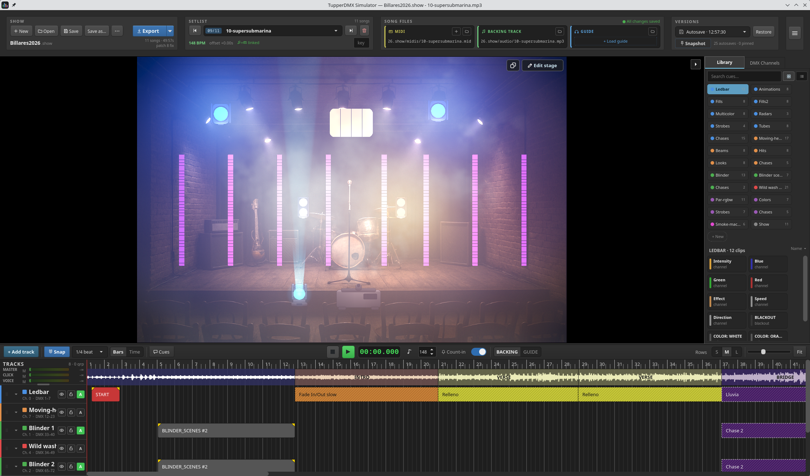
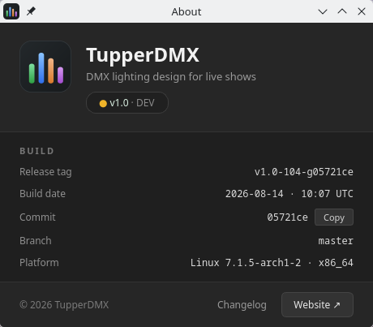

# 1. Introduction

TupperDMX Simulator is a lighting-control application for live bands. It plays a
backing track, runs a click for the drummer, fires DMX lighting cues from a MIDI
timeline, and draws the result on a virtual stage — all from one clock, so the
lights land on the beat whether or not any lighting hardware is plugged in.

It is built for the band that runs its own show: you design the lighting at home
against a virtual rig, carry the whole project to the venue in one folder, and
run the night from a tablet.



## 1.1 What it does

**Audio and click.** One stereo output carries three buses — the backing track,
the metronome click and a spoken voice guide. Each has its own volume and mute.
The click can be sent to one side and the backing to the other, so the musicians
hear the click on in-ears while the room hears only the music.

**MIDI-driven lighting.** Each song owns a MIDI file, edited in the app as
*clips* on a timeline — one lane per patched fixture. A clip is not a note in the
musical sense: it is an instruction to a light.

**A virtual stage.** Every patched fixture is drawn in real time from the DMX
that is actually being sent, with beams, haze, smoke and — on machines with a
usable OpenGL driver — a high-dynamic-range renderer with volumetric fog. What
you design at the kitchen table is what the rig does at the venue.

**A software DMX controller.** A pure-Python controller emulating a hardware
lighting desk is built in. With the factory settings it runs in-process and
feeds the stage directly, so **the app is fully usable with no hardware at
all** — no interface, no MIDI cable, no lights. When there *is* a rig, the same
controller drives it over Art-Net or a USB DMX interface.

**A tablet remote.** An optional web page on the local network shows the
setlist, the current section, a visual metronome, a scrubbable waveform and a
grid of manual light cues. It is how the show is actually run from the stage.

## 1.2 The five words you need

The rest of this manual leans on five terms. They are worth ten seconds each.

**Show** — a project. A show is a *folder* named `MyBand2026.show/` holding a
`show.json` manifest, the MIDI files it owns, any audio that came in with it,
show-local fixture definitions and a `versions/` history. Opening a show
replaces the setlist and the patch. One folder is the whole gig.

**Song** — one entry in the setlist. A song carries a backing track, a MIDI
file, a BPM, a time offset, an optional musical key, an optional count-in and an
optional *guide* track (a full-mix reference used for design that is never
played live).

**Fixture and patch** — a fixture is one light. *Patching* it means giving it a
DMX start address, a MIDI channel and a place on the stage. The patch lives in
the show, so two shows can use completely different rigs.

**Clip** — one instruction on one fixture's timeline lane. Its MIDI **note** is
a *verb* (set a channel, load a scene, run a chase, black out), its MIDI
**channel** selects **which fixture** the verb applies to, and its **velocity**
is that verb's parameter. That is the whole model, and everything in the
timeline follows from it.

**Scene and bank** — a saved look for one fixture type: a set of channel values
with a name. Scenes live in *banks* (`FILLS`, `STROBES`, `BEAMS`…) so a MIDI
verb can address them by number. Scenes belong to the fixture **type**, so every
show that uses that type shares them.

## 1.3 Requirements

| | |
|---|---|
| Operating system | Linux, Windows or macOS |
| Python | 3.13 or newer (only when running from source) |
| Audio | any output device the system exposes |
| Lighting hardware | **none required** — optional Art-Net node or USB DMX interface |
| MIDI hardware | **none required** — optional MIDI output port |
| Graphics | any; the HDR stage renderer additionally wants a working OpenGL driver |

The spoken count-in and voice TTS need a text-to-speech voice, downloaded on
demand (about 60 MB, once) from **Settings ▸ Audio**. Everything else works
without it.

## 1.4 Installing and running

From a release build, run the executable. From source, dependencies are managed
with [uv](https://docs.astral.sh/uv/):

```bash
git clone https://github.com/lothwen/tupperDMX-simulator.git
cd tupperDMX-simulator
uv sync                    # install dependencies, create .venv
uv run python main.py      # run
```

### Rack mode

```bash
uv run python main.py --headless
```

Headless mode runs everything except the desktop window: the software
controller, DMX and MIDI output, playback and the web remote. It is meant for a
small box in the rack with no screen, where **the web remote is the only
interface**. It force-enables the remote in memory without writing that choice
to your preferences, and never downloads a TTS voice.

The app defines four flags — `--headless`, `--show PATH` (open a specific show
folder), `--list-dmx-usb` (print the USB DMX interfaces this machine can see)
and `--dmx-usb INDEX|auto` (send DMX out of one of them for this run, without
touching your preferences). Anything else on the command line is handed to Qt,
so `-platform`, `-style` and friends still work.

## 1.5 Where things are stored

Two locations, with a strict division of labour.

**The show folder** holds everything about *the gig*: the setlist, each song's
files and settings, the fixture patch and the web-remote cues. It is
self-contained and portable — copy the folder, or export a `.showpack` bundle.
By default new shows are created under `Documents/TupperDMX/`.

**The preferences file** holds everything about *this machine*: audio device,
I/O routing, log level, window sizes, and whether this box has a GPU worth using
for the stage. It never contains show data, so moving a laptop between venues
never drags a setlist along with it.

| Platform | Preferences |
|---|---|
| Linux | `~/.config/tupperDMX/userprefs.json` |
| Windows | `%APPDATA%\tupperDMX\userprefs.json` |
| macOS | `~/Library/Application Support/tupperDMX/userprefs.json` |

Deleting `userprefs.json` resets the application to factory settings. **It does
not touch any show** — your projects are separate folders with their own version
history.

## 1.6 About this manual

Chapter 2 lays out the three ways this software gets used, because which one you
are in decides how much of the rest matters. Chapters 3 to 10 then describe the
interface surface by surface, and chapter 11 walks a complete show from an empty
project to a gig, cross-referencing the rest. Appendix A is the raw MIDI note
layout, for when you need to read or write the notes directly; appendix B builds
the bootable image for a rack box.

Every screenshot in this manual was taken from the running application against a
real setlist, using the capture script that lives beside these pages.



**☰ ▸ About TupperDMX** shows exactly which build you are running. The **Copy**
button next to the commit puts the hash on the clipboard, which is the single
most useful thing to include when reporting a problem.
