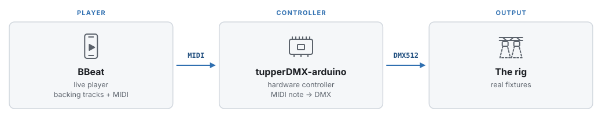
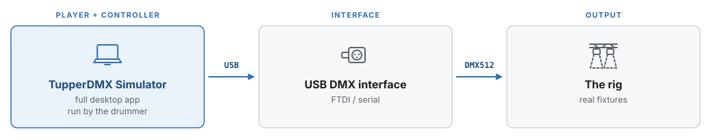
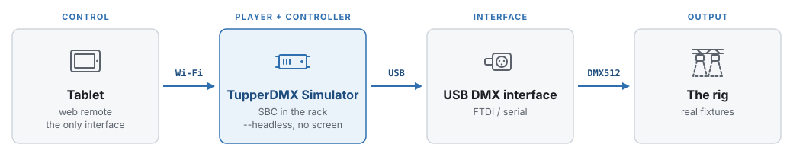

# 2. Operating modes

The same show can be run three different ways. They differ in *which box plays
the music*, *which box turns MIDI into DMX*, and *what the operator touches* —
and that choice decides how much of this manual applies to you.

All three end in the same place: a DMX universe driving real fixtures. What
changes is everything upstream of it.

| | Plays the audio | Makes the DMX | Operator touches | Chapter |
|---|---|---|---|---|
| **Mode 1** | BBeat | tupperDMX-arduino | the player | the design chapters only |
| **Mode 2** | TupperDMX Simulator | TupperDMX Simulator | a laptop on stage | all of it |
| **Mode 3** | TupperDMX Simulator | TupperDMX Simulator | a tablet | all of it |

## 2.1 Mode 1 — BBeat and the Arduino controller



The band already runs a live player — **BBeat** — for its backing tracks and
click. That player also sends the MIDI that the show's lighting is written in.
A companion project, **tupperDMX-arduino**, receives those notes on a
microcontroller and turns them into DMX for the rig.

Nothing in this chain is a computer running a desktop application. It is small,
boots instantly, and has nothing to crash mid-set.

**Where this application fits.** It is the *design tool*. You build the fixture
patch, write the lighting on the timeline and check the result on the virtual
stage, then export the song's MIDI (**SHOW ▸ Export ▾ ▸ Export MIDI…**) and load
that into BBeat. On the night, this software is not running at all.

> The internal software controller in this application is a port of the Arduino
> firmware's own logic, so a note that produces a look here produces the same
> look there. That is the whole point of designing against the simulator: the
> verbs, the scene banks and the channel layouts are shared.

**What matters to you in this manual:** the stage designer
([4](#4-the-stage-view)), the fixture browser ([5](#5-the-add-fixture-dialog)),
the timeline ([6](#6-the-timeline)), the clip library
([8](#8-the-clip-library-and-the-dmx-monitor)) and the auto program
([11](#11-the-auto-program)), which writes a first draft of a song's lighting
for you to refine. The I/O routing page matters
only for previewing while you work — leave it on **All software**.

## 2.2 Mode 2 — the laptop on stage



One machine does everything. The full desktop application plays the backing
track, runs the click, sequences the MIDI, turns it into DMX with its internal
controller, and pushes that out of a USB DMX interface into the rig. Typically
the laptop sits by the drummer, who starts each song.

This is the simplest chain to set up and the one with the most control during a
show: the whole timeline, the stage and the DMX monitor are in front of you, and
a fixture can be re-patched between songs.

It is also the chain with a laptop screen on stage, which is a decision about
sightlines as much as about technology.

**Setup:** **Settings ▸ Input / Output**, quick mode **Software + real lights**,
then tick **USB DMX** and pick the interface. Or use Art-Net instead if the rig
is on a network node. → [9.1](#91-input-output)

**What matters to you in this manual:** all of it.

## 2.3 Mode 3 — headless in the rack, run from a tablet



The same application, on a small board in the rack, started with `--headless`.
It has no window and needs no screen: it boots into the show, plays the audio,
sequences the lighting and drives the USB DMX interface exactly as the laptop
would. The **web remote** is the only interface, on a tablet on a mic stand.

This is the configuration for a band that does not want a laptop visible, and it
is the most robust of the three on stage — nothing to knock, nothing to sleep,
nothing to accidentally click.

The trade is that you cannot edit during the show. The remote gives you the
setlist, transport, a free-running click, manual light cues and a blackout; it
does not give you the timeline. Design happens beforehand, on a normal machine, and travels to
the rack as a `.showpack` bundle.

```bash
uv run python main.py --headless
```

> Headless mode force-enables the web remote so there is a way in, and that
> switch lives only in memory — it never rewrites the preferences of the machine
> it is running on.

**Setup:** design on a laptop, **SHOW ▸ Export** a bundle, import it on the rack
machine, set its I/O routing once, then start it headless. →
[10.4](#104-rack-mode), [7.1](#71-show-the-project)

The rack machine does not have to be a general-purpose computer. **Appendix B**
builds a single bootable image that comes up straight into headless mode, with
no login, no desktop and nothing else installed. →
[Appendix B](#appendix-b-building-a-rack-image-with-buildroot)

**What matters to you in this manual:** all of it for design, and chapter
[10](#10-the-web-remote) for the night itself.

## 2.4 Choosing

- **Already running BBeat live?** Mode 1. Use this software to design and export,
  and change nothing else about your rig.
- **Want one box to do everything, and happy to have it on stage?** Mode 2.
- **Want the show run from a tablet with nothing else visible?** Mode 3.

Modes 2 and 3 are the same software with a different front end, so moving
between them costs nothing: the show folder is identical, and only the I/O
routing and the choice of `--headless` differ. Mode 1 shares the fixture
definitions and the note vocabulary but not the runtime, so the hand-off there
is the exported MIDI file.
