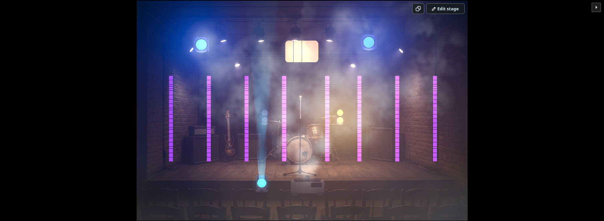
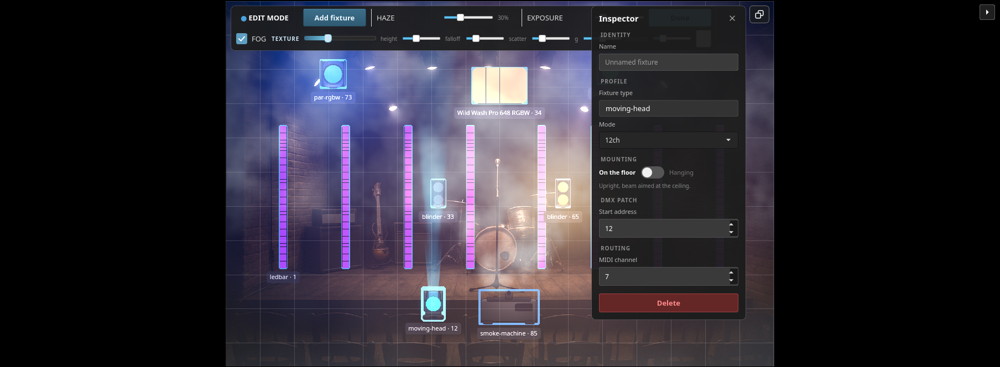
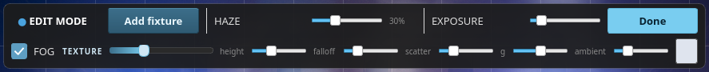
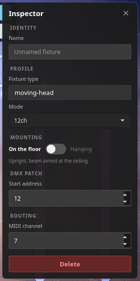
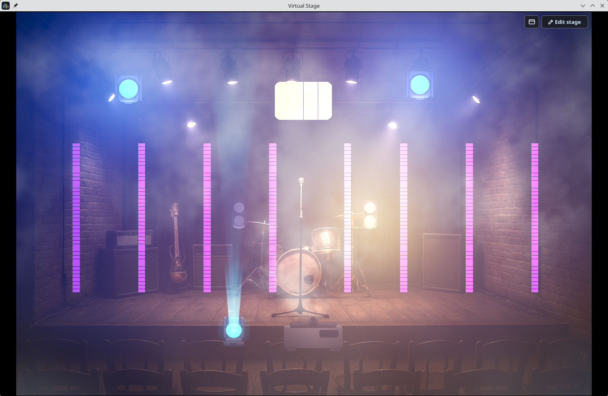
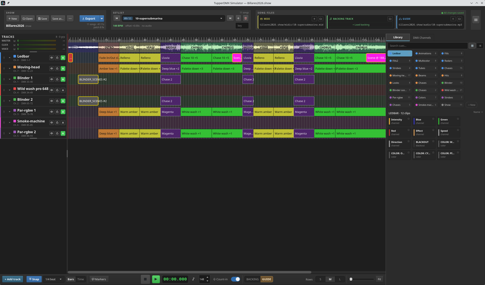

# 4. The stage view

The stage is not a diagram. It is a renderer fed by the DMX that is actually
leaving the application, so a beam on screen is a beam the rig would throw.

It has two modes. Normally it just draws — nothing on it can be clicked, dragged
or knocked out of place, which is what you want during a show. **Edit stage**
turns it into the designer.

## 4.1 What you are looking at

Two things decide how a fixture is drawn, and they are decided separately.

**Its category picks the body and the kind of light it makes.** A moving head
gets a yoke and a shaft; an LED bar gets a row of pixels; a wash panel gets a
surface that glows without a visible shaft at all.

**Its channels pick the shape of that light.** Whatever capabilities the
fixture's DMX channels declare — zoom, gobo, prism, frost, colour mixing,
strobe — become layers that shape the beam. There is no per-fixture drawing
code: a fixture the application has never seen before still renders from its
definition.

**Haze is what makes a beam visible.** In clean air a light throws no shaft at
all; you would see only the lens and the pool it lands in. The **HAZE** slider
sets how much haze is in the air *before* any hazer or smoke machine in the
patch runs — and any fog-producing fixture adds to it on top.

Fixture sizes on stage are deliberately **not** to scale. Every body is
normalised to a similar size so that a beam and a glow read correctly next to
each other; at true scale a scanner head sits inside its own beam and a large
wash panel has no room to glow.

## 4.2 Entering the designer

Click **Edit stage**. The button disappears, a faint grid appears over the stage
picture, and the edit toolbar drops into the top-left corner.

The grid is a visual aid only — **the stage does not snap.** (The timeline does;
the stage does not.)

## 4.3 The edit toolbar

| Control | What it does |
|---|---|
| **● EDIT MODE** | A label, so it is obvious the stage is live for editing |
| **Add fixture** | Opens the fixture browser — chapter [5](#5-the-add-fixture-dialog) |
| **HAZE** | 0–100 %. How much haze is in the air before any hazer runs. The percentage beside it updates live |
| **EXPOSURE** | 0.1× – 4.0×. How hard the rig is driven before highlights roll off to white. *Only present when the GPU renderer is running* |
| **Done** | Leaves edit mode |

**HAZE moves immediately.** Unlike a real hazer, which drifts up over seconds,
dragging the slider snaps the air straight to the new level — nobody adjusting a
slider wants to wait twelve seconds to see what they did.

**Done does not "apply" anything.** Every edit in the designer — a drag, a
rename, a new address, a deletion — is saved the moment you make it. *Done* only
puts the stage back into playback mode.

### The fog row

The second row appears only when the GPU renderer is running. It shapes
volumetric fog — instead of scaling each beam by one stage-wide haze number, the
renderer marches every view ray through the air that is actually there, so a
shaft brightens as it crosses a bank of smoke and god rays fall out on their own.

| Control | What it does |
|---|---|
| **FOG** | The master switch. **While it is off, every slider beside it does nothing** |
| **TEXTURE** | How ragged the air is. At 0 the air is a perfectly smooth medium — the translucent-sheet look. Around 1 a pocket of air can be completely empty, which is what gives a shaft its billows. Higher still, the billows separate into banks with clear air between them: a stage under a smoke machine rather than under a hazer |
| **height** | How far up from the floor the fog reaches |
| **falloff** | How sharply it thins with height. Haze settles, so a slab of even density reads as wrong |
| **scatter** | How much of the light passing through comes back to you |
| **g** | Forward scattering. This is why a beam aimed at you is blinding and the same beam across the stage is a shaft |
| **ambient** | A stage-wide key on the air itself, so smoke is visible before any fixture is |
| *swatch* | What colour the air scatters |

> **There is no fog density control here, and that is deliberate.** Density *is*
> the **HAZE** slider on the row above — the fog pass reads it as the amount of
> medium in clean air. The controls on this row shape that medium; they do not
> add more of it.

Turning the GPU renderer on and off is a separate, machine-level decision that
lives in **Settings ▸ Virtual stage** ([9.4](#94-virtual-stage)) — quality
settings there, appearance here.

## 4.4 Placing fixtures

A new fixture drops at the centre of the stage. Drag it where it belongs.

- The position is only visual while you drag; it is **written down when you let
  go**.
- A multi-body fixture — an eight-segment LED bar, say — moves **one body at a
  time**. That is how the bars get spread across the truss.
- Each fixture carries a label beneath it while editing, reading its name and
  DMX start address (`moving-head · 12`). On a multi-body fixture only the first
  body is labelled.

**Where you drop it decides how it is rigged.** Anything landing in the upper
third of the picture is assumed to be flown; anything lower is assumed to stand
on the deck. It is a starting guess, written down once and then left alone — a
guess re-evaluated during the drag would flip a fixture over halfway across the
stage. Correct it in the Inspector whenever the guess is wrong.

## 4.5 The Inspector

Select a fixture and the Inspector appears in the top-right corner. It is every
per-fixture setting, right next to the fixture on the stage.

The same settings are also reachable without coming here — off a timeline lane
or a clip-library card — in the **Edit fixture** dialog
([5.6](#56-editing-a-fixture-you-have-already-patched)),
which adds the type's scenes and chases and checks the DMX address for an
overlap, which this card does not.

| Section | Field | Notes |
|---|---|---|
| **IDENTITY** | Name | Free text. Shows on the timeline lane and the DMX monitor. Blank falls back to the type name |
| **PROFILE** | Fixture type | Read-only. A type's DMX footprint is not editable from here |
| | Mode | **Only shown when the type declares more than one mode.** Changing it changes the channel layout, so the body is rebuilt |
| **MOUNTING** | On the floor / Hanging | **Only shown for fixtures that can be flown.** A smoke machine or a floor can always stands on its own feet, so it gets no switch |
| **DMX PATCH** | Start address | 1–512 |
| **ROUTING** | MIDI channel | 0–15. See the warning below |
| | **Delete** | Asks for confirmation, and says how many bars go with it for a multi-body fixture |

**Mounting** flips two things at once: the housing turns upside down, and the
beam is aimed at the floor instead of the ceiling. The hint under the switch says
which state you are in — *"Upside down, beam aimed at the stage."* or *"Upright,
beam aimed at the ceiling."*

> **The MIDI channel is the fixture's identity as far as your clips are
> concerned.** Every clip on a timeline lane is bound to its fixture by that
> channel, not by name or address. Two fixtures may not share one: the app
> refuses with *"MIDI channel N is already used by another fixture"* and puts the
> old value back. Changing a channel on a fixture that already has clips moves
> those clips to whatever fixture now owns that channel — set it once, when you
> patch.

Closing the Inspector with the **✕** simply clears the selection; it does not
undo anything.

## 4.6 The stage in its own window

Click the undock button and the stage becomes a separate **Virtual Stage**
window. The main window hands its whole height to the timeline, and the sidebar
moves in beside it.

The stage cannot be closed into nowhere — closing the floating window docks it
back into the main window. If it opens on a display that is no longer connected,
**☰ ▸ Dock stage** retrieves it.
