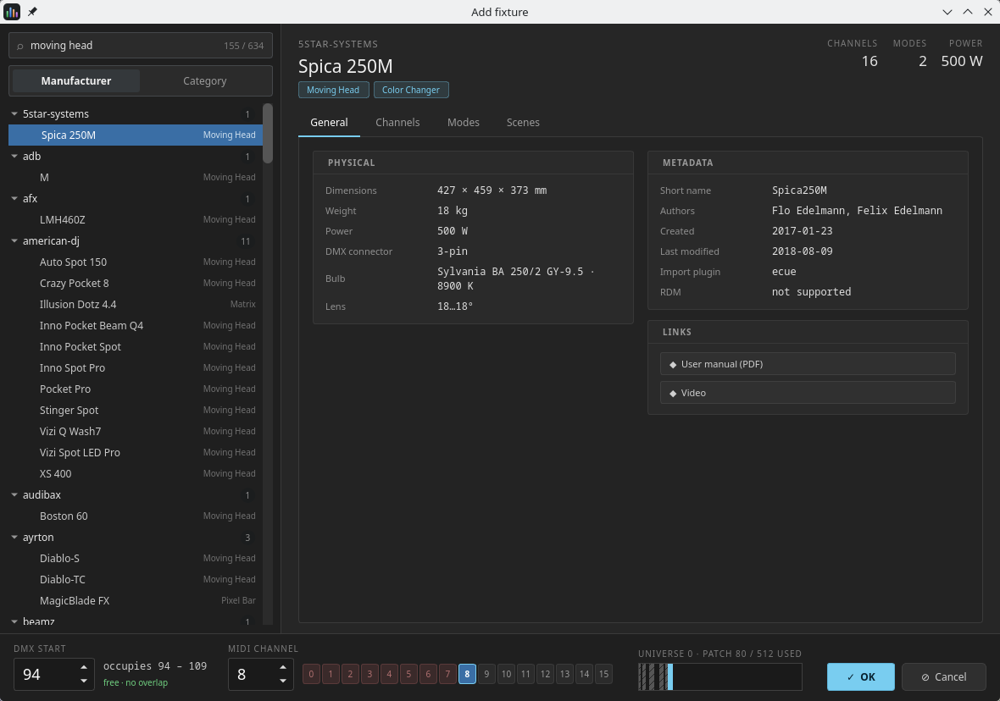
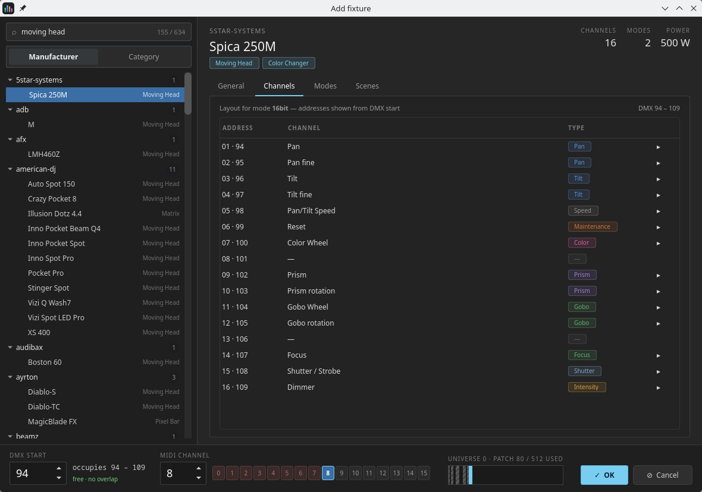
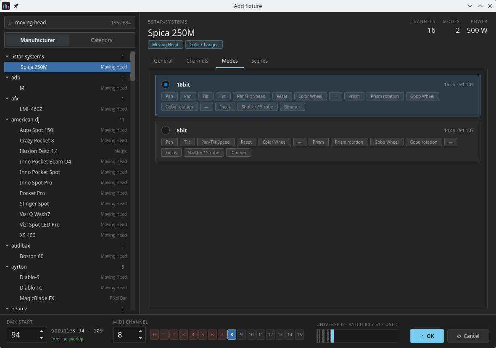
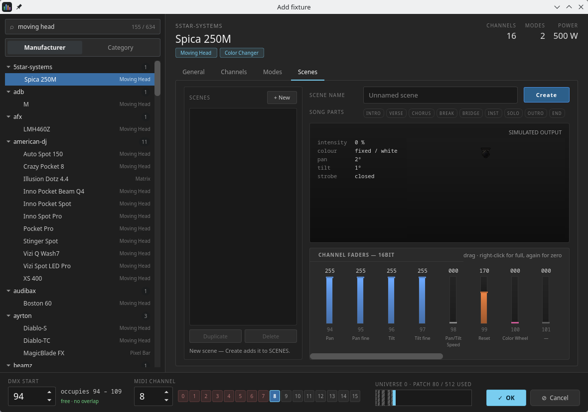
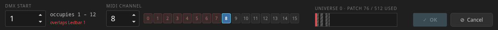
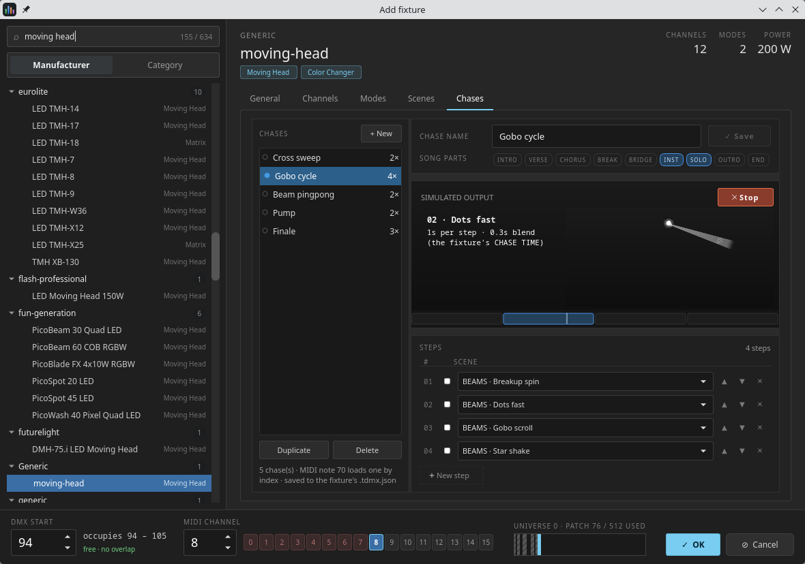
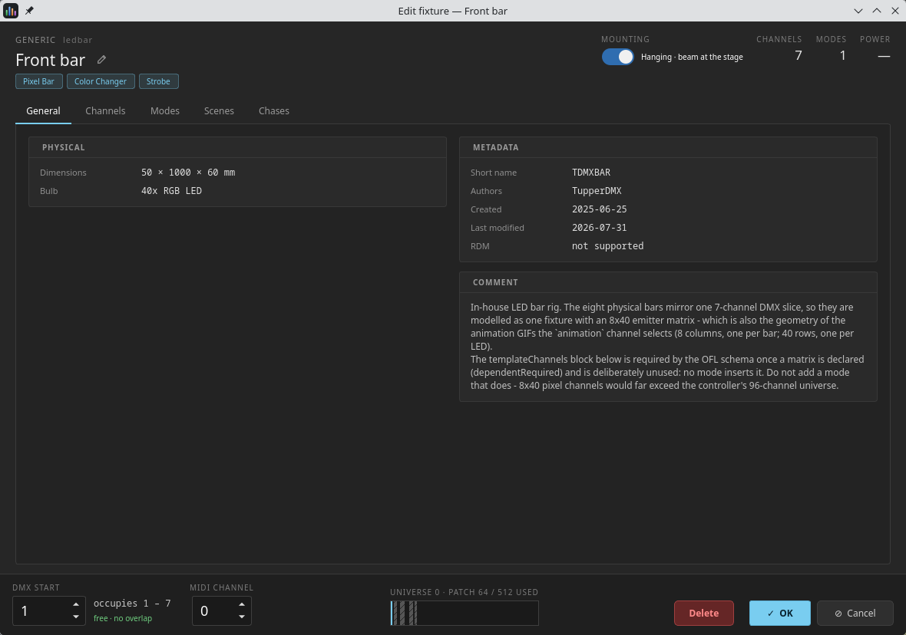

# 5. The Add fixture dialog

Reached from **Edit stage ▸ Add fixture**, or straight from the timeline with
**+ Add track** (a timeline lane *is* a patched fixture, so both open the same
flow).

The dialog has three regions, and they answer three different questions:

1. **the library**, on the left — *which fixture?*
2. **the detail tabs**, in the middle — *is this really the one?*
3. **the footer**, along the bottom — *where does it go?*

Only the footer changes your show. Everything else is a browser.

## 5.1 The library

The fixture library is the [Open Fixture Library](https://open-fixture-library.org/)
format, so any OFL definition works. Fixtures come from three layers, each
overriding the one before: the definitions shipped with the application, the
ones you have added under your preferences folder, and any that travel inside the
open show.

**Search** (`Search fixtures, manufacturers…`) matches across manufacturers and
fixture names, and the counter beside it shows how much of the library you are
looking at — `155 / 634`. Groups start collapsed and expand automatically while
you are searching.

The **Manufacturer | Category** segmented control changes how the tree is
grouped. Whichever grouping you are *not* using appears as a dim caption on each
row, so a manufacturer-grouped list still tells you that *Spica 250M* is a Moving
Head. Fixtures with no manufacturer folder collect under **Generic**;
uncategorised ones under **Uncategorised**.

## 5.2 The detail tabs

At the top of the panel: the manufacturer, the fixture name, its category chips,
and three headline numbers — **CHANNELS**, **MODES**, **POWER**.

### General

Up to four cards, each hidden when the definition has nothing to put in it:

- **PHYSICAL** — dimensions, weight, power draw, power and DMX connectors, bulb,
  lens.
- **METADATA** — short name, authors, created and last-modified dates, the
  import plugin the definition came through, and RDM support.
- **LINKS** — buttons that open the manufacturer's manual, product page or video
  in your system browser.
- **COMMENT** — whatever notes the definition carries.

### Channels

Every DMX slot of the currently selected mode, **addressed from the DMX start
you have picked in the footer** — so the `ADDRESS` column reads `01 · 94`, the
slot within the fixture and the real universe address side by side. The caption
above the table names the mode, and the range appears on the right.

Each row carries the channel name and a colour-coded type chip (`Pan`, `Tilt`,
`Intensity`, `Color`, `Gobo`, `Shutter`, `Maintenance`…). The **▸** on the right
expands the row into that channel's capability ranges — the low and high DMX
values, what the manufacturer calls each one, and its capability type.

A slot the parser could not resolve is shown as **—** and kept in place. It still
consumes an address, which is what keeps the rest of the layout honest.

### Modes

One card per mode: a radio button, the mode name, its short-name chip, its
footprint (`16 ch · 94-109`), and a flow of every channel name in it. This is
where you choose which mode to patch. The **Channels** tab follows your choice.

**Pick the mode the fixture is actually set to.** A moving head in its 8-channel
mode patched here as 16-channel will respond to the wrong addresses for
everything after the first few.

### Scenes

This tab edits stored looks for the fixture **type** — see
[5.4](#54-the-scenes-tab).

### Chases

Sequences built from those scenes, again for the **type** — see
[5.5](#55-the-chases-tab).

## 5.3 The footer — the patch decision

| Control | What it tells you |
|---|---|
| **DMX START** | The address, 1–512. Beside it, `occupies 94 – 109` and the status: `free · no overlap`, `overlaps Ledbar 1`, or `needs 16 ch · past 512` |
| **MIDI CHANNEL** | The channel, 0–15, with all sixteen as clickable buttons. Channels already in use are marked, and picking one says `already used`. **On a narrow window the sixteen buttons fold away** — the footer is the widest row in the app — leaving the spin box, which refuses a used channel just the same |
| **PatchBar** | The whole universe as a strip. Hatched blocks are already patched, the solid blue block is where this fixture would land — **and it turns red when it collides** |
| **UNIVERSE 0 · PATCH n / 512 USED** | How much of the universe the show is using |
| **✓ OK** / **⊘ Cancel** | **OK stays disabled until the patch is legal** |

You cannot create an illegal patch from this dialog — and editing a fixture you
have already patched goes through this same footer ([5.6](#56-editing-a-fixture-you-have-already-patched)),
so you cannot edit your way into one either.

> The stage **Inspector** ([4.5](#45-the-inspector)) refuses the same two
> things on the fields it offers — a used MIDI channel, and an address that
> overlaps or runs past 512 — but one at a time, as a warning that puts the old
> value back, rather than as a footer that keeps OK disabled. Its **Mode**
> switch is the one edit it lets through: a mode with more channels can grow a
> fixture onto its neighbour, which it reports as a standing warning
> ([4.5](#45-the-inspector)) rather than refusing.

## 5.4 The Scenes tab

A *scene* is a named set of channel values for a fixture type, stored in a
*bank*. Banks and scene numbers are what the MIDI verbs address, which is why
they are numbered rather than just named.

**Left panel.** A tree of banks with their scenes beneath. Each scene shows a
colour swatch painted by the real renderer and, if it has any, abbreviated
song-part tags. **+ New** offers **New scene** and **New bank…**; **Duplicate**
and **Delete** work on whatever is selected. Banks and scenes are renamed
in place by clicking the name, and reordered by dragging.

It opens at about a third of the tab's width — so a wide window gives a wide
list — and **the divider between the two panels drags**, for when your bank
names want more room than that (or less).

**Right panel.** The scene name, a row of nine song-part chips (INTRO, VERSE,
CHORUS, BREAK, BRIDGE, INST, SOLO, OUTRO, END — tag a scene and the app will
offer it automatically during that part of a song), the **SIMULATED OUTPUT**
card, and the channel faders.

**SIMULATED OUTPUT** is the stage's own renderer fed the values you are dialling,
next to a read-out of what they resolve to — intensity, colour, pan and tilt,
strobe, effect, zoom. It is not an approximation of the stage; it *is* the stage.

**CHANNEL FADERS** is a lighting console. Press anywhere on a fader and the value
jumps there, then follows the drag. **Right-click flashes a channel to full;
right-click again returns it to zero.** A channel whose capabilities name
discrete options gets a **▾** beside its name — click it and those options appear
as a grid of live tiles (animated, when the definition ships artwork for them).

**The workflow** is: dial a look → type a name → **Create**. Selecting an
existing scene loads it and the button becomes **Save**. The status line under
the tree always says where you stand — *"New scene — Create adds it to
SCENES."*, *"Unsaved changes — press Save to write them to the fixture's
.tdmx.json."*, or a count of what is stored.

> **Two things about this tab are worth knowing before you use it.**
>
> **It is not covered by OK and Cancel.** This tab edits the fixture *library*,
> which every show using that type shares. **Create** and **Save** write to disk
> immediately. Cancelling the dialog does not undo them. (If the definition sits
> somewhere the app cannot write — inside the application bundle — it is forked
> into your own fixtures folder first, and your copy wins from then on.)
>
> **A saved song binds a scene by its position, not its name.** MIDI verbs
> address "scene 3 of bank 1". Renaming a scene or a bank is safe. **Inserting,
> deleting or reordering scenes shifts the numbering, and existing songs will
> load a different look.** Add new scenes at the end of a bank, or in a new bank,
> once a show depends on them.

## 5.5 The Chases tab

A *chase* is an ordered walk through scenes — again stored on the fixture
**type**, alongside its banks, and written to the same `.tdmx.json` sidecar.

**Left panel.** The chases this type declares, each with its step count
(`4×`). **+ New**, **Duplicate** and **Delete** work the same way as on the
Scenes tab, the name is renamed in place by clicking it, and the divider drags.
The status line underneath says what the list is for — *"5 chase(s) · MIDI note
70 loads one by index · saved to the fixture's .tdmx.json"*.

**Right panel.** The chase name and its **Save** button, the nine song-part
chips, **SIMULATED OUTPUT** with a **Run** button, and the **STEPS** table.

**Pick a chase and it starts running.** A chase *is* its motion — a still
picture of one step tells you almost nothing about it — so selecting one plays
it through the preview straight away. **Run** becomes **Stop** for the times
you would rather it held still, and moving to another chase runs that one.
Leaving the tab stops it.

**STEPS** is the chase itself: one row per step, each naming a scene. **New
step** adds one, and the scene picker offers every scene of the type, bank
first.

> **A step names its scene by bank NAME and position in that bank.** So a chase
> survives renaming a bank — the rename rewrites every chase that pointed at it
> — but **not** reordering the scenes inside one, which leaves the chase
> stepping through whatever now sits at those positions. The same warning as
> [5.4](#54-the-scenes-tab), for the same reason.

> **SONG PARTS are the one control here the runtime honours in full.** Tag a
> chase and auto mode will run it during that part of a song, exactly as it
> picks a tagged scene. **An untagged chase can only ever be fired by hand**
> (MIDI note 70), which from the audience is indistinguishable from a chase
> that does not work.

> **Per-step timing is not offered**, because the engine cannot play it: it runs
> every chase forwards on one per-fixture CHASE TIME. There is no direction,
> no seconds/beats choice, and no per-step fade, hold or level — Run steps at
> the engine's own rate, which is what you will hear from the rig.

## 5.6 Editing a fixture you have already patched

Everything above is about *adding* a fixture. Once one is in the show, the same
dialog edits it — it is the same set of answers, so it is the same dialog. Only
the first question is already settled: **there is no library rail**, because you
cannot swap a patched fixture for another type. All five tabs and the whole
footer are exactly as described above, now pointed at your fixture; the header
gains the two things that belong to *this* fixture rather than to its type —
its name, and how it is rigged.

**Three ways in:**

| Where | Gesture |
|---|---|
| The timeline | **Double-click a lane header**, or right-click it and choose **Edit '<fixture>'…** |
| The clip library | **Right-click any card** and choose **Edit '<fixture>'…** — it opens **on that scene or chase**, not merely on its tab |
| The clip library | The **+ New** tile at the end of the pill row |

**The title becomes the fixture.** Give one a name and the big heading is that
name, with the model stepping back beside the manufacturer — a rig has three
Wash 12s, and calling all three "Wash 12" is what naming them was for. Leave it
unnamed and the heading is the model, as everywhere else.

**Rename it in place**: the **✎** beside the title, or a **double-click on the
title itself**. Enter or clicking away commits, Escape puts the old name back —
and Escape here cancels the rename only, not the dialog.

Beside the title, **MOUNTING** — whether the fixture is flown (upside down,
beam at the stage) or standing on the deck. It only appears for a fixture whose
profile can hang at all; a smoke machine always sits on its own feet.

**In the footer**, the same patch decision as when adding — **DMX START**,
**MIDI CHANNEL** and the universe bar, validated live and disabling **OK** while
the choice is illegal. The one difference: the fixture's *own* address and
channel are left out of that check, so it does not report itself as a clash.

**Changing the mode** is the **Modes** tab, exactly as when adding. Because
scene banks are stored per mode, switching it re-points the Scenes and Chases
tabs at that mode's banks; anything unsaved is offered to you first.

**OK applies, Cancel discards** — the name, mounting, address, channel and mode
are all held until you press OK. **The Scenes and Chases tabs are the exception
and always were:** they edit the fixture *library*, shared by every show using
that type, and they write when *their* buttons say so ([5.4](#54-the-scenes-tab),
[5.5](#55-the-chases-tab)).

**Delete** removes the fixture from the show. It asks first, then closes — it is
not held until OK.

> **The sixteen channel buttons fold away on a narrow window.** The footer is
> the widest row in the app and an edit dialog carries a Delete button the add
> one does not, so below about 1270px the overview collapses to its spin box
> rather than squeezing into an unreadable smear. Nothing is lost: the spin box
> still refuses a channel already in use.

> **Which fixture opens, when a type is patched twice?** A clip library group is
> per fixture *type*, so a card belonging to a type you have patched twice
> resolves to the **first by DMX address** — the same instance that card's own
> click would fire at. The menu names it, so you can see which you are getting.
> The timeline route has no such ambiguity: a lane is one instance.
