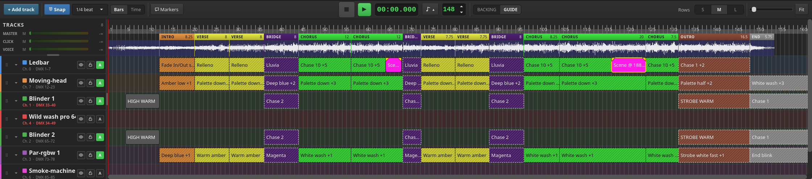
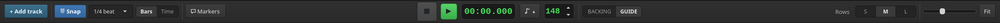
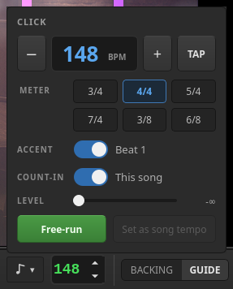
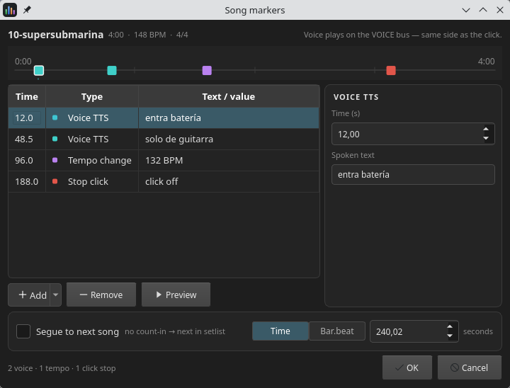
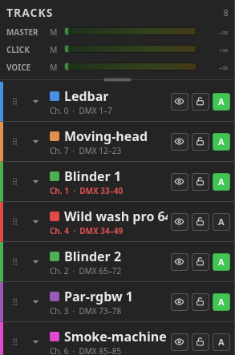
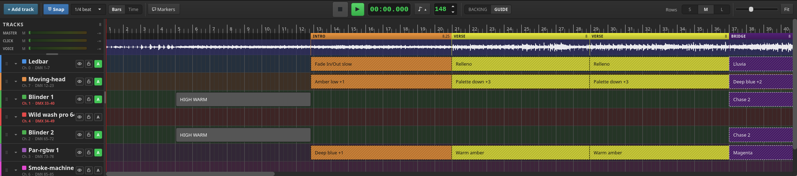
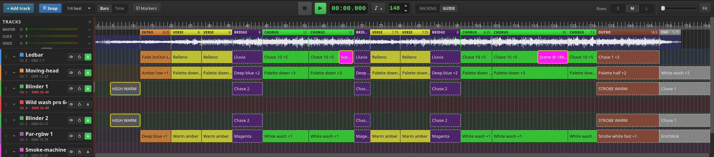
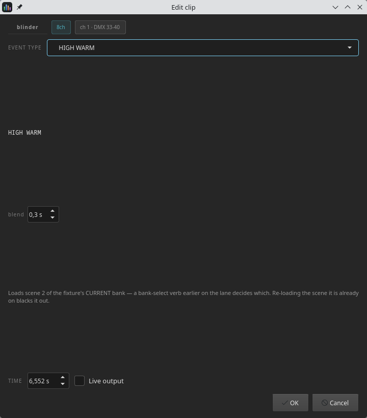
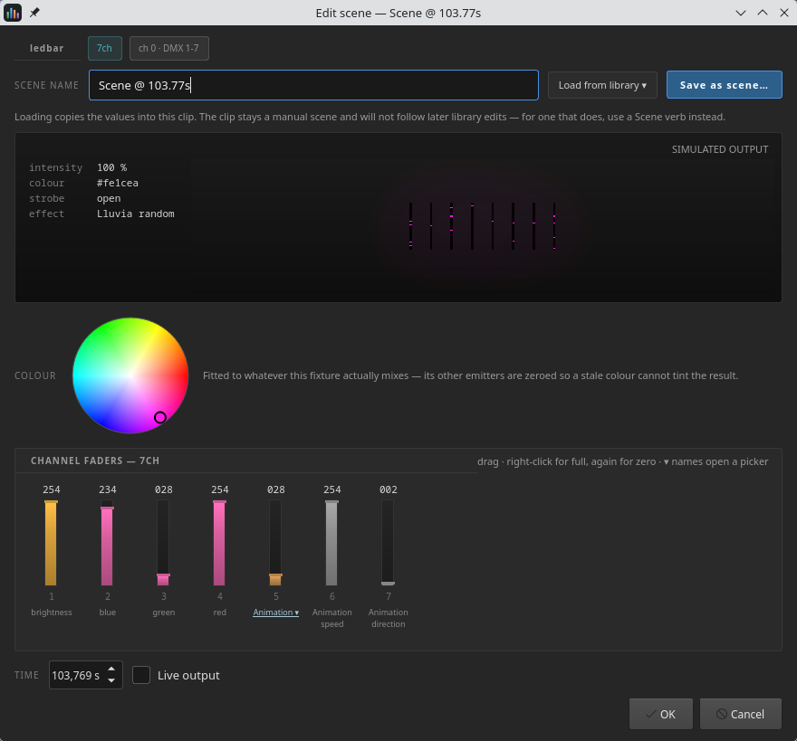
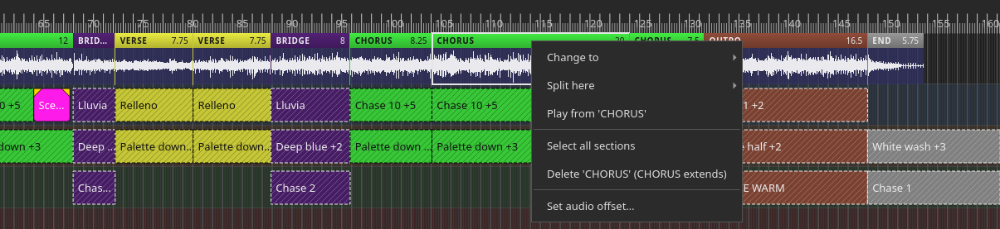

# 6. The timeline

The timeline is where a song's lighting is written. It shows the song's audio as
a waveform, its arrangement as labelled sections, and its lighting as *clips* on
one lane per patched fixture.

## 6.1 The transport bar

It sits directly above the tracks, and moves to the bottom edge when the stage is
undocked.

### 6.1.1 Left — edit controls

| Control | What it does |
|---|---|
| **+ Add track** | Patches a new fixture. Opens the stage designer and the fixture browser together — a lane *is* a fixture |
| **Snap** | Snapping on/off. **On by default** |
| **1 beat / 1/4 beat / 1/8 beat** | How fine the grid is. `1/4 beat` by default |
| **Bars \| Time** | What the ruler counts. Bars by default |
| **Markers** | Opens the marker-track editor — [6.1.4](#614-voice-tts-and-control-markers) |

### 6.1.2 Centre — transport

Stop, play/pause, the position read-out (`00:00.000`), the **click button**
(**♩ ▴**) and the song's **BPM**.

**BPM** accepts 40–300. Anything outside that range is refused with a dialog
naming the limits. The timeline can also detect a tempo from the audio.

The metronome is still **muted from the CLICK row** in the header column; the
click button opens the click panel.

| Row | What it does |
|---|---|
| **Tempo** | **−** / **+** step one BPM, or type it. **TAP** sets it from the beat you tap: the average of the last few taps, started over by a pause of two seconds |
| **METER** | 3/4, 4/4, 5/4, 7/4, 3/8 or 6/8 |
| **ACCENT** | Gives beat 1 its own, stronger sound. Off, every beat sounds alike |
| **COUNT-IN** | This song's count-in, on or off — [6.1.3](#613-count-in) |
| **LEVEL** | The click's volume. It *is* the CLICK slider in the header column; move either and the other follows |
| **Free-run** | Plays the click on its own, at the panel's tempo and meter, with the transport stopped. The button becomes **Stop** |
| **Set as song tempo** | Makes the panel's tempo and meter the song's own. Greyed out until they differ from what the song has |

**Tempo and meter in the panel are a draft.** The panel opens on the song's own
values, and nothing reaches the song until **Set as song tempo** — so you can tap
along to a record, or click the drummer through a passage at another tempo,
without touching the song. **Accent**, **count-in** and **level** are different:
they apply as you change them.

A free-run follows the draft while it plays, re-timing once you stop changing
it. It is unavailable while the song plays — the song's own click has the
output then — and starting or stopping the song ends it. With the panel closed,
the click button stays lit for as long as a free-run is going; one started from
the web remote ([10.2](#102-the-panel)) shows here too.

**A song has one meter**, and the ruler, the click, the count-in, the markers'
bar.beat and the web remote all count in it. **The BPM always counts quarter
notes**, whatever the meter: in 3/8 or 6/8 the click ticks the eighths, two to
each quarter, so 6/8 at 120 BPM is six clicks a bar, at 240 a minute.

### 6.1.3 Count-in

The count-in is **per song**: the **COUNT-IN** switch in the click panel, and
the **PRECOUNT** column of the playlist manager ([7.2](#72-setlist-the-songs)),
are the same setting. On, the song begins with a counted-in bar or two; off, it
segues straight out of the previous song. How many bars — and whether the last
one is spoken aloud — is set once for the machine in **Settings ▸ Audio**
([9.3](#93-audio)). A count-in bar is a bar of the song's own meter: six clicks
in 6/8.

A count-in is *negative timeline time*: playback starts before zero and the
audio, MIDI, lights and metronome all begin together at t = 0. The position
read-out counts down with a minus sign (`−0:03.200`) while it runs. Pausing
during a count-in resets to zero; seeking cancels it.

### 6.1.4 Voice TTS and control markers

**Markers** opens the current song's *marker track* — everything that happens at a
point in the song without being a note. The strip along the top shows them laid
out over the song; drag one to move it. The table lists them in time order, and
the panel on the right edits whichever is selected.

Four kinds:

| Marker | What it does |
| --- | --- |
| **Voice TTS** | Speaks a line on the **VOICE** bus — in split routing the same side as the click, so it reaches the band and not the room. **Preview** renders the selected line and plays it. |
| **Tempo change** | Retimes the click from that point on, and re-draws the bar grid to match. The song's *base* tempo — what the `.mid` stores — is not touched. |
| **Stop click** | The click stops there and stays off for the rest of the song. Seeking back before the marker brings it back. |
| **Segue** | At the given time the show hands over to the next song in the setlist and starts it **with no count-in**. One per song, set with the tick box along the bottom. |

The **Time / Bar.beat** switch changes the units every time in the dialog is
shown and entered in. Bar.beat is read through the song's tempo map, so a
position after a tempo change converts differently from one before it.

Markers appear on the ruler in their own lane above the bar numbers, each a
flag coloured by kind — teal for voice TTS, violet for a tempo change, red for
the stop-click, amber for the segue — carrying its own name. **Drag a flag to
move the marker**; while you drag it, a dashed line runs down the arrangement
so you can see what you are landing on. **Double-click one** to open this
dialog on that marker.

Voice TTS needs a TTS voice installed (**Settings ▸ Audio**). Without one the
dialog warns *"TTS voice not ready (Settings ▸ AUDIO) — voice TTS stays
silent."* and nothing is spoken. The other three kinds do not use TTS and work
regardless.

### 6.1.5 BACKING | GUIDE

A song may carry a *guide* track — a full mix used as a design reference. This
switch chooses which of the two you are monitoring and which waveform is drawn.

> The monitor is **session-only**. It is never saved, always starts on BACKING,
> and **never affects what a live surface plays**. MIDI, DMX, the metronome and
> the markers are driven by the timeline and are identical under either.

The **GUIDE** button stays disabled until the current song actually has a guide
file.

### 6.1.6 Right — view controls

| Control | What it does |
|---|---|
| **Rows S \| M \| L** | **S collapses every lane** (it is not a height). M = 50 px, L = 80 px, and both resize the timeline section to fit |
| Zoom slider | 20 % – 400 %. Mirrors Ctrl+wheel and **Fit** |
| **Fit** | Zooms so the whole song fits the width |

On a narrow window these three fold into a single **View ▾** button, whose popup
holds the same controls — the transport bar is wider than a 1280-pixel screen
with everything shown.

## 6.2 What a clip is

This is the one idea the whole chapter rests on.

> A clip carries a MIDI **note**, a MIDI **channel** and a **velocity**.
> The **note is a verb** — set a channel, load a scene, run a chase, black out.
> The **channel selects which fixture** the verb acts on.
> The **velocity is that verb's parameter**.

So a clip is always edited *against the fixture whose lane it lives on*, never
against a general table of notes. The same note number means different things on
different fixtures, and the app resolves it from the patch every time.

Verbs are grouped by number:

| Notes | Verb |
|---|---|
| 1 – 23 | Set channel *n* of this fixture (DMX value = velocity × 2) |
| 24 – 35 | Load scene 0–11 of the fixture's current bank (velocity = blend time) |
| 36 – 47 | Select bank 0–11 |
| 48 / 49 / 50 | Take manual control / manual / black out this fixture |
| 51 | Black out everything (a toggle) |
| 52 – 59 | Timing, palette and scene-step verbs |
| 61 – 69 | Song parts (INTRO, VERSE, CHORUS…) |
| 70 | Run a chase |
| 72 – 75 | Colour macros |

Notes 60 and 71 are missing from that table on purpose. They are the fixture's
own **state** rather than anything authored against the music: 60 is its colour
palette (Palette tab of the fixture dialog, [5.6](#56-the-palette-tab)) and 71 its per-track auto / mute
/ lock flags (the lane header). Both sit at t=0 in the `.mid`, one per fixture,
and neither ever appears as a clip.

**Only a fixture's first 23 DMX slots can be driven from the timeline**, because
notes 24 and up are already scene verbs. Channels past that are still patched,
still rendered, and still reachable from the fixture's stored scenes — they just
cannot be authored clip by clip.

## 6.3 Anatomy

### The header column

At the top, **TRACKS** with a live count, then the three output buses. Each is a
label, an **M** mute button, a level slider and a decibel read-out (`0dB` at
full, `-∞` at zero):

- **MASTER** — the backing track
- **CLICK** — the metronome
- **VOICE** — the spoken count-in and voice TTS

Below them, one header per fixture:

| Element | What it does |
|---|---|
| grip | Drag to reorder the lanes. The order is remembered with the show |
| chevron | Collapses the lane to a single row. View only |
| colour swatch | Matches this fixture's group in the clip library and its section in the DMX monitor |
| name / `Ch. 0 · DMX 1–7` | The fixture's name over its MIDI channel and address range. **It turns red when those channels are shared with another fixture** — see below |
| **eye** | Mutes this lane's MIDI output. Its clips redraw dimmed |
| **lock** | Makes the lane read-only: no moves, no resizes, no new clips, no editing |
| **A** | Follow the song-part program automatically |

**Double-click the header** — anywhere on it that isn't one of those controls —
to open the **Edit fixture** dialog for that lane's fixture
([5.7](#57-editing-a-fixture-you-have-already-patched)):
its name, mode, address and MIDI channel, and its type's scenes and chases.
Right-clicking the header offers the same thing as a menu item. A lane *is* one
patched fixture, so there is never any doubt which one you get.

**The header says so as you point at it**: the fixture's colour stripe down the
left edge lightens, and the address line underneath the name turns into
*"Double-click to edit"*, then goes back to the address when you move away.

> **A red address line means two fixtures are sharing DMX channels.** Both
> lanes turn red, not just the one you changed — they are equally wrong, and
> either one can be moved to fix it. Point at the line and the tooltip names
> what it collides with; double-click the header and the Inspector spells the
> clash out and refuses any address that would keep it. The line keeps its own
> words either way: the header row has no space to spare, and the address is
> the thing you need to read.
>
> You cannot patch your way into this from the **Add fixture** dialog, which
> disables OK ([5.3](#53-the-footer-the-patch-decision)). It comes from a
> **Mode** change in the Inspector growing a fixture onto its neighbour, or
> from a show whose patch was already overlapping when it loaded.

### The lanes

The ruler runs along the top in **Bars** or **Time**. Beneath it the waveform
band: the song's arrangement as a row of coloured header bars, each naming its
part (INTRO, VERSE, CHORUS…) and its length in bars, with the waveform drawn
underneath, tinted in each section's colour ([6.10](#610-song-sections)). Then the
fixture lanes, ordered by DMX start address. A red playhead crosses the lot.

Two kinds of block appear on a lane, and telling them apart matters:

- **Clips** — solid, rounded, coloured by the verb. These are yours: click,
  drag, resize, edit, delete.
- **Auto blocks** — square-cornered, diagonally hatched, dashed border. These
  appear only on lanes whose **A** button is on. They are a *preview of the
  automatic song-part program*, not editable and not saved.

A clip's colour comes from its verb; a scene group's is mixed from its channel
values, so a warm look is a warm block. Muted lanes draw everything at about a
third opacity.

### BLACKOUTs are the gaps

Between clips, a lane is not empty — it holds invisible **BLACKOUT** markers.
They are never drawn and cannot be clicked. They exist so a clip's extent is
explicit: a gap is a decision, not an absence.

This has one consequence you will meet within the first hour:

> **`Delete Event` does not delete a clip. It replaces it with a blackout.**
> That is why neighbouring clips do not expand to fill the hole. To actually
> remove the marker afterwards, right-click it and choose **Remove blackout**.

## 6.4 Undo and redo

**Ctrl + Z** and **Ctrl + Shift + Z**. Every committed edit is undoable, and
multi-step edits collapse into a single step.

There is no undo button, no menu entry, and nothing greys out when the history is
empty — pressing Ctrl+Z with nothing to undo simply does nothing.

## 6.5 Selecting

| Action | Result |
|---|---|
| Click a clip | Selects just that one |
| **Ctrl + click** a clip | Adds it to / removes it from the selection |
| Drag on empty lane space | Rubber-band marquee; everything it touches is selected. Dragged up into the waveform band, it picks up song sections too |
| **Ctrl + drag** on empty space | Same, but keeps the existing selection |
| Click empty space, or the waveform (no drag) | **Seeks the playhead** to that point |

Selected clips get a warm gold border.

With two or more clips selected the timeline enters *multi mode*: fade handles
disappear, edge-resizing is switched off, the whole body of every clip becomes a
move handle, and dragging any one of them slides the entire selection as a rigid
block.

Selection survives redraws — it is tracked by clip, not by screen position.

A selection can hold clips and song sections at once. Dragging moves both by
the same amount, **Delete** takes both, and either way it is one step for
**Ctrl+Z**.

## 6.6 Moving, resizing and fading

Grab a clip in the middle to **move** it. Grab within about 8 pixels of either
edge to **resize** from that side; the cursor changes to tell you which you are
about to get. On a clip too narrow to have a middle, the left half resizes left
and the right half resizes right.

- **Nothing is written until you let go.** Everything during the drag is a
  preview.
- **Clips never overlap.** A move is clamped by its neighbours, and can hop over
  one when there is a big enough slot on the far side.
- **Snapping** pulls the edge you are dragging to nearby clip edges and to the
  finest visible grid line — bars and their subdivisions in Bars mode, seconds in
  Time mode. Turn it off with **Snap** on the toolbar.

**Fades** are the two small gold triangles on a clip's top edge: the left one is
where the fade-in ends, the right one where the fade-out begins. Drag them along
the clip. There are no cross-fades — each handle treats the other as a wall — and
shortening a clip shrinks any fade that would have fallen off it. Fade handles
are not offered on blackouts, on locked lanes, or while several clips are
selected.

## 6.7 Adding clips

Three ways, all equivalent:

1. **Drag from the clip library** (chapter [8](#8-the-clip-library-and-the-dmx-monitor)).
   The drop is validated live: over a lane where the verb has no meaning, over a
   locked lane, or over a fixture whose type does not match the scene you are
   dragging, the cursor shows *rejected*. **Song parts are the exception — they
   drop onto the waveform band**, not onto a fixture lane, because they belong to
   the song rather than to a light; see [6.10](#610-song-sections) for what a
   drop there does.
2. **Right-click a lane** and choose **Add event at this position**.
3. **Ctrl + V** pastes a copied selection at the playhead.

## 6.8 Context menus

Right-clicking a clip gives, in order: **Edit Properties…** (omitted on a
blackout), **Add event at this position**, and **Delete Event** — or **Remove
blackout** on a blackout. With several clips selected, the menu collapses to a
single **Delete N events**.

Right-clicking empty lane space offers only **Add event at this position**.

Right-clicking a song section, or the empty waveform band, has its own menu —
[6.10](#610-song-sections).

Right-clicking a lane *header* offers **Edit '<fixture>'…**, which opens that
fixture's own dialog ([5.7](#57-editing-a-fixture-you-have-already-patched)).

Hovering a clip shows its part name, note number, time, bar and beat, and
velocity.

## 6.9 The clip editor

Double-click a clip, or use **Edit Properties…**. Which editor opens depends on
what the clip is.

### A single verb

The header names the fixture, its mode and its placement (`ch 1 · DMX 33-40`).

**EVENT TYPE** lists every verb that is meaningful *on this fixture* — the
picker is gated by exactly the rule drag-and-drop uses, so the dialog can never
author a clip a drop would have refused. Below it sits **that verb's own
control**, because a chase index and a blend time are not the same thing:

| Verb | Control |
|---|---|
| Set a channel | A console fader, coloured by channel family, captioned live with what the capability under that value means (`200 of 255 — ColorIntensity`, `· 4.2 Hz`, `· 45°`) |
| Load a scene | The scene it targets, plus a **blend** time |
| Bank + scene in one | A **bank** and a **scene** drop-down |
| Run a chase | The chase, by name |
| Blend / colour / chase timing | A seconds spin, 0.0 – 12.7 |
| Blackout, take manual, … | No parameter — just a line explaining what it does |

> **Retyping a clip resets its velocity.** A channel-at-200 clip has velocity
> 100; carried across to "run a chase", that would select chase number 100.
> The editor deliberately starts the new verb from its own default.

**TIME** re-times the clip. It goes through the same search as a drag, so it can
refuse when there is no room — the clip then simply stays where it was.

### A scene group

A *scene clip* is seven simultaneous events sharing an identity, drawn as one
block. Editing it opens the full console: the scene's name, **Load from library
▾**, **Save as scene…**, the **SIMULATED OUTPUT** card, a **COLOUR** wheel
(offered only when the fixture actually mixes a colour) and the fader strip.

**Load from library** copies a stored scene's values into this clip. The clip
stays a *manual* scene and will not follow later library edits — if you want one
that does, use a Scene verb instead.

**The fader strip** works like the one in the fixture browser: press anywhere to
jump, drag to follow, right-click for full and again for zero, **▾** on a channel
name to pick from that channel's own options.

Two behaviours are specific to scene editing:

- **Channels the scene does not carry are drawn dimmed.** Move one and it joins
  the scene. This is not cosmetic: at runtime an absent channel keeps whatever
  the previous frame left in it, while a present channel at its default *forces*
  that value. Submitting every fader would silently widen the scene.
- **Channels past DMX slot 23 are greyed out**, for the reason in
  [6.2](#62-what-a-clip-is).

> **"Save as scene…" writes to the fixture library immediately.** It is not part
> of OK, and Cancel will not undo it — it edits a fixture *type*, which every
> show using that type shares. If the name already exists, the app offers to
> overwrite in place, and recommends it: a saved song binds a scene by position,
> so adding a second scene with the same name shifts everything after it.

### Live output

The **Live output** checkbox sends what you are dialling to the rig while you
edit.

- It is **never on by default and never remembered** — this dialog gets opened in
  front of an audience, and a fader drag would be visible.
- It is **disabled while the transport is playing** (the sequencer would fight
  it for the same channels) and on a locked lane.
- Payloads lead with a *take manual* instruction, or the automatic program would
  overwrite the preview on the next frame.
- **Cancel re-sends what the clip held when the dialog opened.** That is a
  re-send, not a restore: it cannot put back what the automatic program was
  doing.

### The palette is not a clip

Note 60 (**START**) used to be a draggable clip with an editor of its own. It is
the fixture's colour palette now — state you set on the fixture, not a cue you
place in the song — so it lives in the **Palette** tab of the fixture dialog
([5.6](#56-the-palette-tab)) and has no representation on the timeline at all.

## 6.10 Song sections

The waveform band carries the song's **arrangement**: INTRO, VERSE, CHORUS and
the rest, one after another from the start of the song to its end. The web
remote shows them to the band, the **A** lanes follow them, and the auto program
([11](#11-the-auto-program)) writes them.

Each section is a coloured **header bar** across the top of the band, with the
part's name on the left and its length in bars on the right (`8`, or `8.25` for
eight bars and a beat). The waveform underneath takes the section's colour.

**A section has no length of its own.** What is stored is where each one
*starts*; it runs until the next one starts, and the last one runs to the end.
So the strip is always contiguous — no gaps, no overlaps — and editing it really
means moving the **boundaries** between sections.

### The bar is the section, the waveform is the audio

The two halves of the band answer different gestures:

| Where | Gesture | Result |
|---|---|---|
| Header bar | Click | Selects the section and seeks there. **Ctrl** adds or removes it, **Shift** extends the selection |
| Header bar | Drag across several | Sweeps a selection |
| Header bar | Drag a selected section | Moves **all** the selected ones together |
| Header bar | Double-click | Picks another part for it from a list |
| A boundary, anywhere down the band | Drag | Moves that one boundary: the section before grows, the one after shrinks |
| Waveform | Click | Seeks |
| Waveform | Drag | Slides the audio against the grid (its **offset**) — see below |

**A single section never moves on its own.** Dragging one would mean moving the
audio under it, which does not move. Drag its edge instead, or select two or
more and move the group.

Everything snaps to the beat while **Snap** is on (hold **Shift** for whole
bars), and nothing can cross or crowd a neighbour: a section is never shorter
than one beat, and never changes its place in the order. **Alt + ←/→** nudges
the selected sections a bar, or a beat with **Shift** as well.

### Adding, retyping and deleting

**Drop a song part** from the clip library's grey **Show** group onto the band.
A ghost shows where it would land. Dropped inside a section, it **splits** it
there; dropped on a section's start, it **retypes** that section instead — two
parts can never stack at one instant.

**Right-click a section:**

| Entry | What it does |
|---|---|
| **Change to ▸** | Retypes it — or every selected section — to another part |
| **Split here ▸** | Starts a new section of the chosen part where you clicked |
| **Play from '<part>'** | Starts playback at the section's start |
| **Select all sections** | |
| **Delete '<part>'** | Removes it; the section before it extends over the gap, as the menu says (`Delete 'BRIDGE' (VERSE extends)`) |
| **Set audio offset…** | See below |

**Right-click the band outside a section** — before the first one, say — and the
menu offers **Add section here ▸** (or **Change '<part>' to ▸** on a start), and
the offset again.

**Delete** removes the selected sections without asking: **Ctrl+Z** puts them
back, like any other edit.

### The audio offset

The waveform below the header bars is the audio, and dragging it slides the
track against the grid — the way to put bar 1 on beat 1. **An offset moves that
one track and nothing else**: clips, sections and markers stay where they are
on the timeline, and a song's guide and backing each have an offset of their
own.

So when you let go, **Move show with audio** asks what should follow:

| Button | Result |
|---|---|
| **Move show** | The clips, song sections and markers move by the same amount — a tick box adds the other audio track |
| **Audio only** | The track keeps its new offset; everything else stays. On a song with nothing on it yet, this is the only choice, and reads **Keep the new offset** |
| **Cancel** | Nothing changes |

**Advanced** in the same dialog takes the offset as a number, or as a move in
beats at the song's tempo. **Set audio offset…** on either band menu opens it
straight there, without a drag — the way to type an exact value. When the show
cannot follow (something would be pushed before the start of the song), the
dialog names what is in the way.
