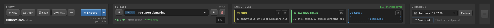
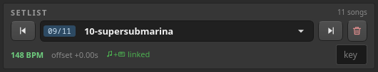
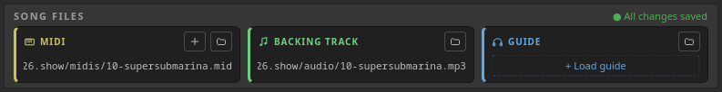
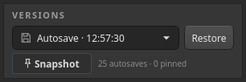
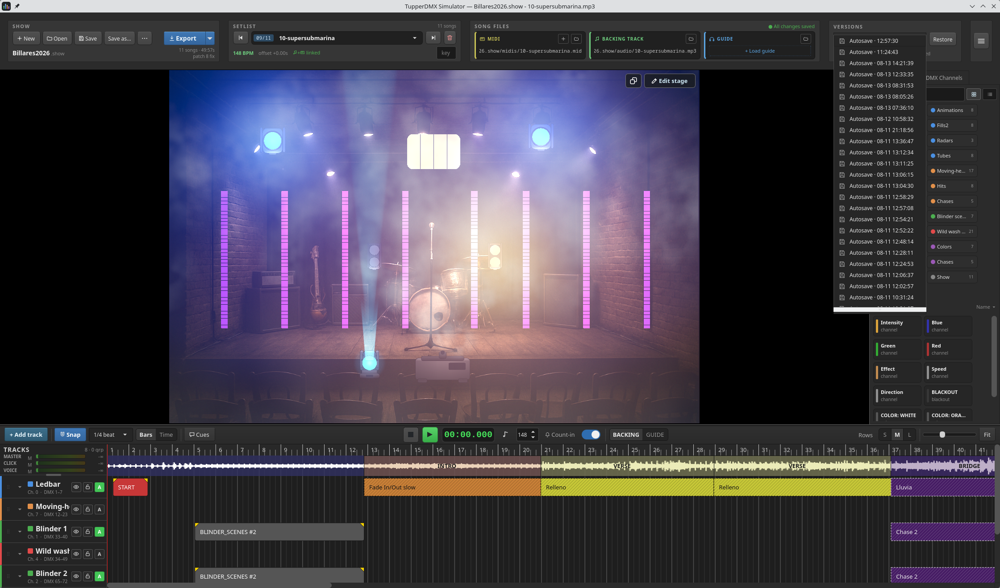

# 7. The top toolbar

Everything about the *project* lives here: which show is open, which song is
selected, which files that song uses, and how far back you can roll it.



## 7.1 SHOW — the project

| Button | What it does |
|---|---|
| **+ New** | Creates a new show project. Asks for a name, then where to put it |
| **Open** | Opens an existing `.show` folder |
| **Save** | Forces a save right now. Autosave already runs — this is for peace of mind before unplugging something |
| **Save as…** | Duplicates the show under a new name. The copy starts with no version history |
| **…** | **Import bundle…** — unpacks a portable `.showpack` |
| **Export** | See below |

Underneath, the show's name and a two-line summary: `11 songs · 49:57s` and
`patch 8 fix`.

### A show is a folder

New shows are created under `Documents/TupperDMX/` by default and look like this:

```
Billares2026.show/
  show.json          the manifest: setlist, patch, cues
  midis/             the MIDI files this show owns
  audio/             audio that arrived inside a bundle
  fixtures/          fixture definitions that travel with this show
  versions/          the snapshot history
```

**Audio is referenced where it lies**, not copied — a 100 MB backing track stays
in your music folder. **MIDI is copied in**: loading a `.mid` puts a copy in the
show's `midis/`, and that copy is what gets edited from then on.

### Export

The **Export** button is a split button, and the two halves do different things.

**Clicking the button body exports a `.showpack` bundle** — one portable file
containing audio, MIDI, the patch and the fixture definitions for *every* song,
including guide tracks. This is the "take the whole gig to another machine"
format, and it is what **Import bundle…** reads back.

The **▾** menu holds:

- **Export MIDI…** — a plain standard-MIDI copy of the *current song only*, for
  opening in a DAW or another lighting tool. It deliberately strips the extras
  that plain MIDI cannot carry (stable scene identities, scene names, per-clip
  fades), so it is an interchange copy, not a backup. Disabled until the song
  has MIDI data.
- **Export bundle** — the same thing as clicking the button body.

## 7.2 SETLIST — the songs



| Control | What it does |
|---|---|
| **◀** / **▶** | Previous / next song. The first and last disable the matching arrow |
| **09/11** | Position in the setlist |
| Song selector | **Pick from the drop-down to switch songs. Type a new title and press Enter to rename the current one** |
| **🗑** | Removes the current song from the setlist (with confirmation). The files stay on disk |

The footer shows the song's tempo, its audio offset, a media chip, and a small
**key** field — the musical key, which is shown on the web remote for the band.

The media chip is worth learning:

| Chip | Meaning |
|---|---|
| `♪+🎹 linked` (green) | Backing track and MIDI both present |
| `♪ audio only` | A backing track, no lighting yet |
| `no audio` | MIDI only |
| `⚠ audio missing` (red) | The file the song points at is not there |
| `⚠ MIDI missing` (red) | Same, for the MIDI file |

### When files go missing

Moving or renaming files behind the app's back is normal, and it copes. When a
song's backing track cannot be found, the app first tries to relink silently —
if exactly one known-good folder (the show's own `audio/`, the folder you last
relinked from, or the folder another song lives in) contains a file of that
name, it is adopted without asking. Otherwise you are offered a file picker.

## 7.3 SONG FILES — the current song's media



Three cards, one per slot. Each shows the path in use, or a dashed **+ Load …**
button when the slot is empty. The small **🗁** in a card's header loads a file
into that slot.

| Card | What it is |
|---|---|
| **MIDI** | The song's lighting. The **+** in its header starts a fresh empty track. Loading a `.mid` **copies it into the show** |
| **BACKING TRACK** | The song's identity — this is what plays live, what the web remote controls, and what a headless rack box runs |
| **GUIDE** | Optional full mix used as a design reference. **Never played live.** The **✕** in its header clears it (the file itself is untouched) |

### The autosave chip

Top-right of this section, and it has exactly three states:

| Chip | Meaning |
|---|---|
| **● All changes saved** (green) | Everything is on disk |
| **● Editing · autosave in 3s** (amber) | An edit is pending; it will be written shortly |
| **⚠ Save error — check logs** (red) | Something went wrong writing. Check the log file |

You do not need to save. The show is written a few seconds after you stop
editing, and always on song switch, on close, and when you press **Save**.

## 7.4 VERSIONS — history



Every save also leaves a point you can come back to.

| Control | What it does |
|---|---|
| Snapshot drop-down | The history, newest first. Autosaves show a save icon and read `Autosave · 12:57:30`; pinned snapshots show an amber pin and their name |
| **Restore** | Rolls the show back to the selected snapshot |
| **Snapshot** | Takes a named snapshot that is **pinned** — never pruned |



Times show as `HH:MM:SS` for today and `MM-DD HH:MM:SS` for older points.

Automatic snapshots are taken when a show is opened and at most once every five
minutes thereafter; older ones are eventually pruned. Anything you name with
**Snapshot** is kept forever.

> **Restoring is itself undoable.** Before rolling back, the app snapshots the
> current state — so if the version you restored was the wrong one, the state you
> just left is sitting at the top of the list.

## 7.5 What is saved where

| Lives in the show folder | Lives in this machine's preferences |
|---|---|
| The setlist and each song's settings | Audio device and routing |
| Which song is current | I/O routing and Art-Net target |
| The fixture patch | Web-remote on/off and port |
| The web-remote cues | Count-in bars, TTS voice |
| MIDI files, bundled audio, show-local fixtures | Stage haze, GPU renderer, fog quality |
| The version history | Window and track sizes, recent shows |

The split is deliberate: a show should carry the gig, and preferences should
carry the box. Copying a show to another machine never drags an audio device or
a graphics setting along with it.
