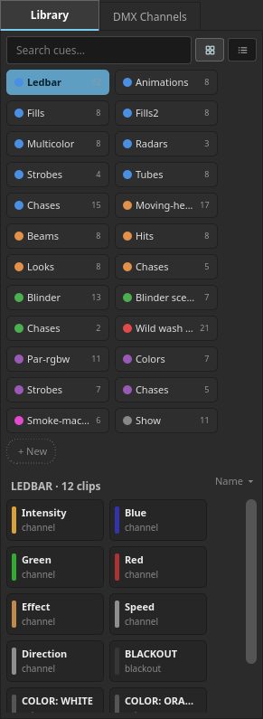
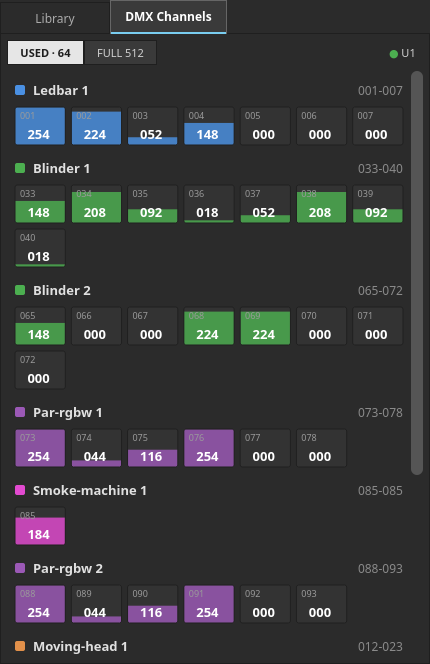
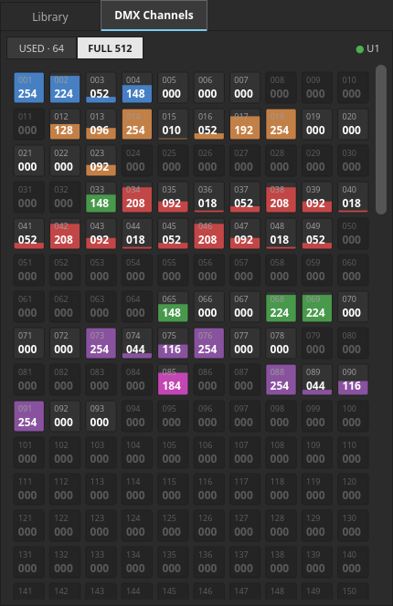

# 8. The clip library and the DMX monitor

The right sidebar has two tabs. **Library** is where cues come from; **DMX
Channels** is where you check what actually went out. The chevron at the top of
the stage slides the whole sidebar away when you want the room.

## 8.1 The Library tab

Everything here is built from **your patch**. Patch a fixture and its cues
appear; remove it and they go.

### Groups

The coloured pills at the top are the groups, and each fixture contributes
several:

- **one group named after the fixture** — its individual channel controls
- **one group per scene bank** the fixture type declares (`Fills`,
  `Multicolor`, `Strobes`, `Beams`, `Looks`…)
- **a `Chases` group** for that fixture's chases
- and, once for the whole show, a grey **`Show`** group holding the global
  verbs: START, the song parts, and blackout-all

A pill's colour dot matches that fixture's timeline lane and its section in the
DMX monitor, so a colour means the same fixture everywhere.

### Cards

Each card is one cue: a title, a subtitle naming its kind (`channel`, `scene`,
`chase`, `color`, `blackout`, `cue`) and a coloured accent bar. A small **✱** on
a scene means its colour comes from the palette rather than from fixed values,
so it follows whatever the START clip set up.

**Three things you can do with a card:**

| Gesture | Result |
|---|---|
| **Click** | Auditions the cue live through whatever output is routed. **The timeline is not touched** |
| **Drag onto a lane** | Inserts it as a clip at the drop point |
| **Right-click** | **Edit '<fixture>'…** — opens that fixture's dialog ([5.6](#56-editing-a-fixture-you-have-already-patched)) **on the very scene or chase the card is for**, ready to edit. A card that is neither (a channel control, a colour macro, a blackout) names no scene, so it opens on the Scenes tab with nothing selected |

A card in the grey **Show** group belongs to the show rather than to a fixture,
and a starred card whose fixture has been unpatched resolves to nobody — neither
offers the menu.

### Making new cues

The **+ New** tile at the end of the pill row opens the same **Edit fixture**
dialog on its Scenes tab, ready to compose one. It uses the fixture the view is
already about — whichever group is selected. When no single fixture owns the
view (the **Show** group, **Favorites**, or an active search) it asks which
fixture you mean first.

Auditioning goes through the same path as everything else, so it respects your
I/O routing — with the factory settings that means the internal controller and
the virtual stage.

### Search

The search box (`Search cues…`) spans **every** group at once, not just the
selected one, and the header switches to `SEARCH · N clips` while it is active.
It is the fastest way to find a scene when you cannot remember which bank it
went into.

> **Not yet implemented:** the grid/list view buttons and the `Name ▾` sort
> label are placeholders. They are drawn but do nothing.

If nothing is patched, the panel says so: *"No fixtures patched. Patch a fixture
(Design stage) or edit the fixture defs."*

## 8.2 The DMX Channels tab

This is the universe as it is right now. Values update live with the show.

Two views, chosen by the segmented buttons at the top:

**USED · N** groups the channels by fixture — a section per patched fixture with
its name, its colour swatch and its address range (`001-007`), and a cell per
channel. Each cell shows the channel number and its current value, with a
coloured fill rising in proportion.

**FULL 512** shows the whole universe in order, with unpatched channels dark and
dimmed. This is the view for "is anything at all being sent on 214?"

The **● U1** chip on the right names the universe being shown.

### Editing channels by hand

While the internal controller is running, the monitor is also a crude console:

| Gesture | Result |
|---|---|
| **Drag a cell vertically** | Fades that channel. The cursor becomes a vertical fader |
| **Right-click a cell** | Toggles it between full and zero |

> These edits are **transient**. The next scene, chase or MIDI event overwrites
> them — which is exactly what you want from a "poke it and see" tool, and
> exactly wrong as a way to build a look. Build looks in the fixture Scenes tab
> or in a scene clip.

Hand editing is only available when there is an internal controller to write to.
With the stage fed from an external Art-Net or USB source, the monitor is
read-only.
