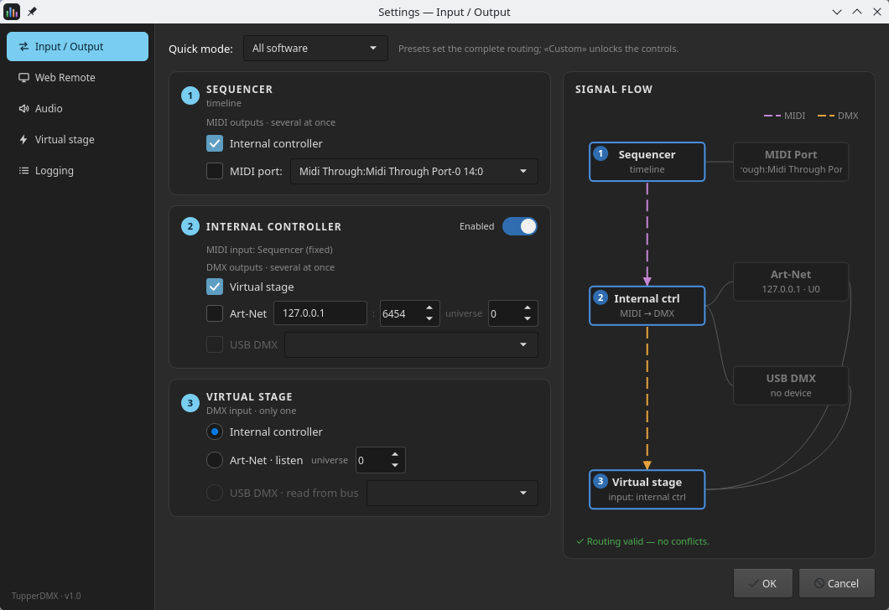
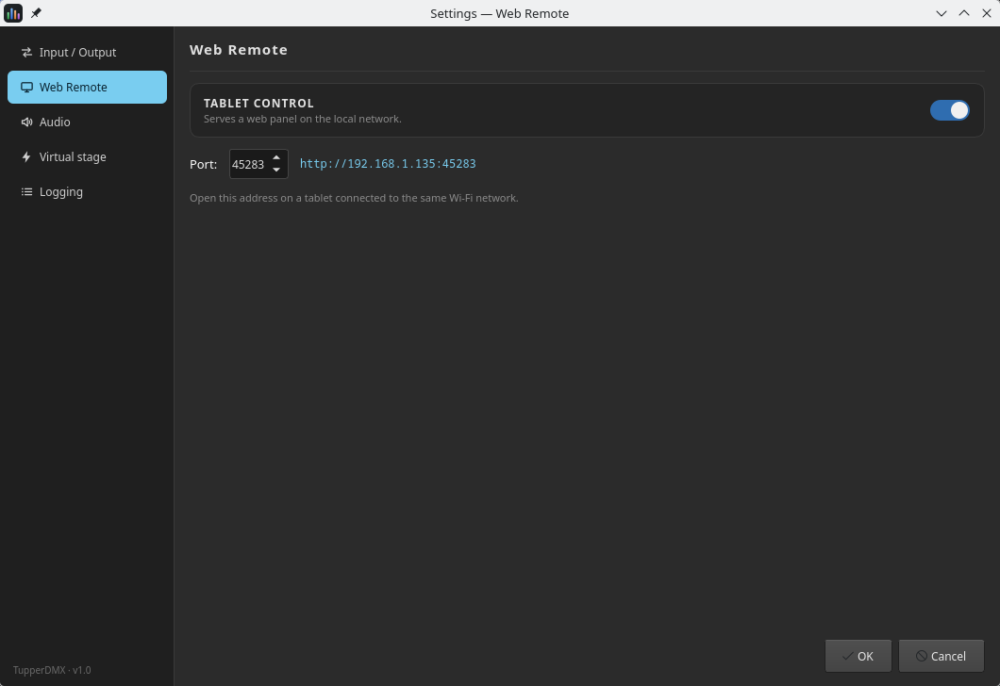
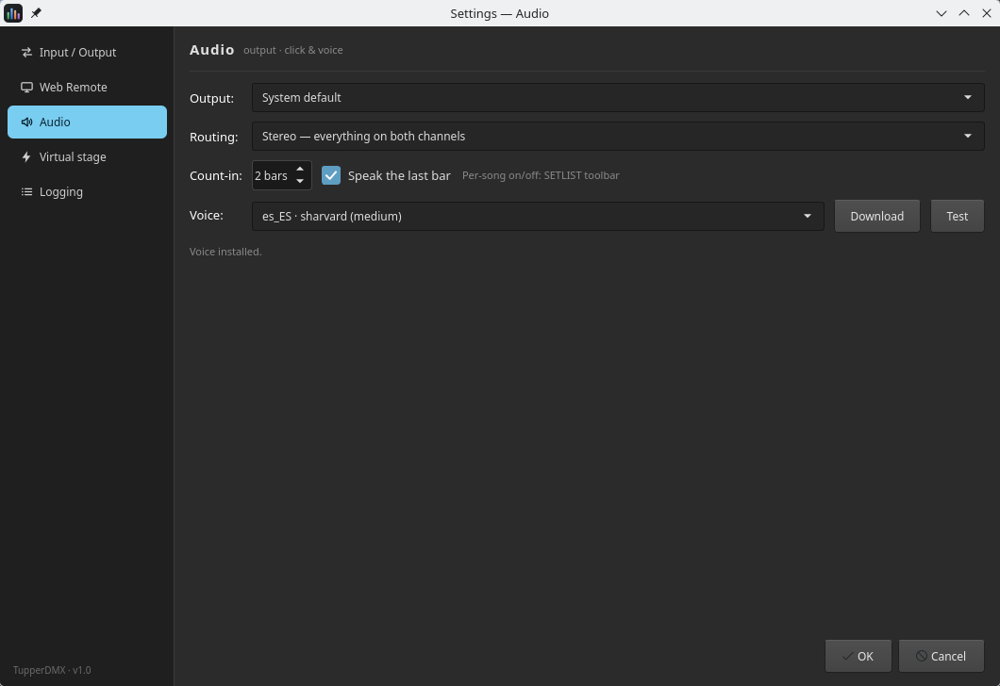
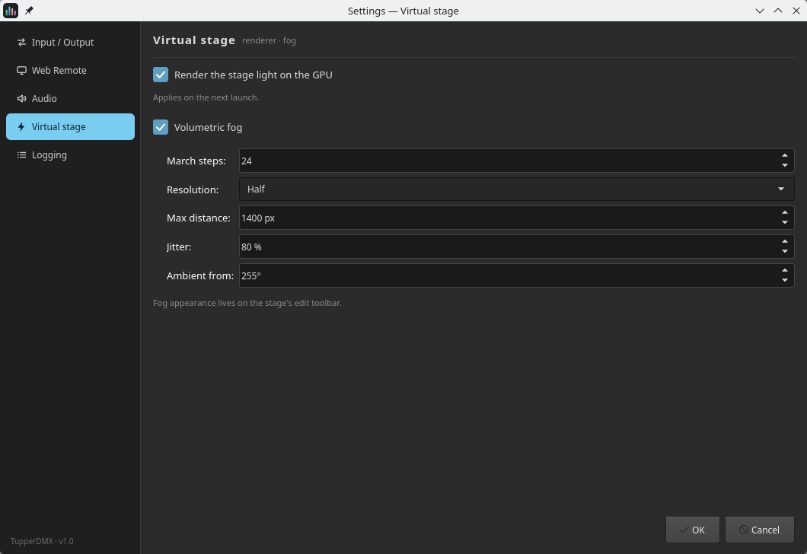
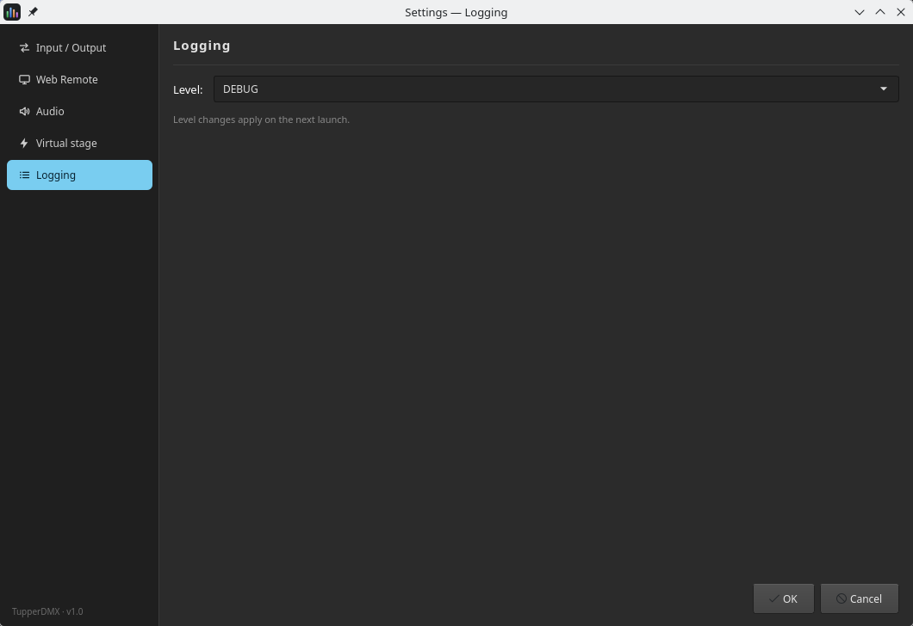

# 9. Settings

**☰ ▸ Settings…** Five pages, chosen from the sidebar. Everything here describes
**this machine**, never the show — so a laptop and the rack box can be routed
completely differently while running the same project.

Changes take effect on **OK**. Two of them explicitly wait for the next launch,
and say so.

## 9.1 Input / Output

This is the most important page in the application, and the one worth reading
before anything stops working.

There is **no localhost magic and no toolbar selector**: all routing is explicit
here.

### Quick mode

The preset drop-down sets a complete routing in one go. Picking **Custom**
unlocks the individual controls.

| Preset | What it is for |
|---|---|
| **All software** | Designing with no hardware at all. The internal controller runs and feeds the virtual stage in-process. **This is the default** |
| **Software + real lights** | The same, plus Art-Net out to a real rig |
| **External rig monitor** | Nothing is generated here; the stage listens to Art-Net and visualises somebody else's desk |
| **Sequencer for HW rig** | The timeline drives an external hardware controller over MIDI, while the internal one still feeds the stage |

### The three cards

They are numbered because the signal really does flow through them in order.

**① SEQUENCER** — the timeline's MIDI output. It can feed several destinations at
once: the **Internal controller** and/or an external **MIDI port**. (The port
drop-down disables itself when the system reports no MIDI outputs.)

**② INTERNAL CONTROLLER** — the built-in lighting desk, with its own on/off
switch in the card header. Its MIDI input is fixed (the sequencer); its DMX
output can go to several places at once: the **Virtual stage**, **Art-Net** (with
IP, port and universe) and **USB DMX** (with a device).

**③ VIRTUAL STAGE** — where the stage gets its DMX *from*, and **only one source
is allowed**: the internal controller, an Art-Net universe it listens to, or a
USB DMX interface it reads from the bus.

The cardinalities are not arbitrary:

- **MIDI output is one-to-many, but MIDI input is one-to-one.** The controller
  speaks a stateful command protocol — "select bank 2", then "load scene 3" —
  so fanning *out* is safe while merging two senders *in* would interleave two
  conversations into nonsense.
- **DMX output is one-to-many**, because each frame is a complete snapshot.
- **Stage input is exactly one**, for the same reason in reverse.

### Signal flow

The right-hand panel draws the routing you have configured — boxes for each
stage, dashed lines coloured by MIDI or DMX, and greyed boxes for destinations
that are switched off. Underneath, a validation strip reads **✓ Routing valid —
no conflicts**, or lists exactly what is wrong. OK refuses an invalid routing.

## 9.2 Web Remote

One switch, one port, and the address the server is reachable at. Open that URL
on a tablet on the same network. Chapter [10](#10-the-web-remote) covers the panel
itself.

While the remote is off, the line reads *"Disabled — no server runs."* — no
socket is opened at all.

## 9.3 Audio

**Output** picks the device. A device you have configured but unplugged stays in
the list marked `(not connected)`, so it is still selected when you plug it back
in.

**Routing** decides how the three buses reach the two channels:

| Mode | Left | Right |
|---|---|---|
| **Stereo** | everything | everything |
| **Split — backing LEFT · click+voice RIGHT** | backing | click + voice |
| **Split — backing RIGHT · click+voice LEFT** | click + voice | backing |

The split modes are what make a single stereo output usable live: send one
channel to the PA and the other to the in-ears, and the room never hears the
click.

**Count-in** sets how many bars (1–8) and whether the last bar is **spoken
aloud**. Whether a *particular song* gets a count-in at all is a per-song switch
on the timeline toolbar — the hint beside the checkbox says so.

**Voice** picks the text-to-speech voice used for the spoken count-in and for
voice cues. Voices are about 60 MB and are **downloaded on demand** — they are
never bundled with the application. **Download** fetches the selected one;
**Test** speaks a phrase through the voice bus. The status line below says where
you stand: *"Voice installed."*, *"Voice not downloaded yet (~60 MB, one
time)."*, or *"TTS engine (piper) not installed — voice features disabled."*

Nothing is ever synthesised during playback — everything is rendered ahead and
cached — so a missing voice degrades to silence rather than to a stutter.

## 9.4 Virtual stage

**Render the stage light on the GPU** accumulates every fixture's light into one
high-dynamic-range buffer and tonemaps it with a filmic curve, so beams *add*
where they cross and blow out instead of flattening to white. It needs a working
OpenGL driver, and falls back to the normal renderer if there is not one.
**It applies on the next launch.**

**Volumetric fog** needs the GPU renderer above, and takes effect immediately.
Its cost controls live here because they are a property of the machine:

| Setting | Notes |
|---|---|
| **March steps** | 4–128. 24 is comfortable on integrated graphics |
| **Resolution** | Quarter (fastest) / Half / Full (slowest) |
| **Max distance** | How far a ray is marched, in pixels |
| **Jitter** | 0–200 %. At 0 the banding comes back |
| **Ambient from** | The direction the ambient light comes from, in degrees |

> **How the fog *looks* is not set here.** Height, falloff, scattering, texture
> and colour are on the stage's own edit toolbar
> ([4.3](#43-the-edit-toolbar)), where you can see what you are changing.
> And there is no density control anywhere on this page, because density is the
> **HAZE** slider on that same toolbar.

## 9.5 Logging

The log level (DEBUG, INFO, WARNING, ERROR, CRITICAL). **It applies on the next
launch.** Logs are written to a dated file in the `logs/` folder next to the
application — the first place to look when the autosave chip goes red.

Leave it on INFO for normal use. DEBUG is worth turning on before reproducing a
problem you intend to report, and worth turning off again afterwards.

## 9.6 Resetting

Every setting on these five pages lives in one file:

| Platform | Path |
|---|---|
| Linux | `~/.config/tupperDMX/userprefs.json` |
| Windows | `%APPDATA%\tupperDMX\userprefs.json` |
| macOS | `~/Library/Application Support/tupperDMX/userprefs.json` |

Delete it to return the application to factory settings. **No show data is in
that file** — your projects are separate folders, with their own history.
