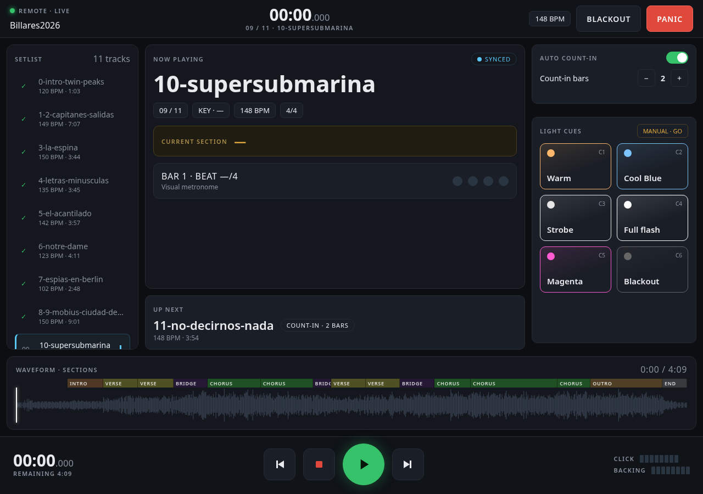

# 10. The web remote

The web remote is a page served on your local network, meant for a tablet on a
mic stand. It is how the show is actually run: the laptop can be closed in a
flight case behind the drum riser.



## 10.1 Turning it on

**Settings ▸ Web Remote** — flip the switch, pick a port, and open the address it
shows on any device on the same network. Nothing is served while the switch is
off.

> **There is no password.** The remote is plain HTTP with no authentication: any
> device that can reach the address can run your show. That is a deliberate
> trade — a login screen on a tablet at the side of a stage, in the dark, thirty
> seconds before a set, is a worse problem than the one it solves. **Put it on a
> network you control.** Do not expose the port to the internet, and prefer a
> dedicated stage router over the venue's guest Wi-Fi.

## 10.2 The panel

### Top bar

The show's name on the left, the running clock and `09 / 11 · SONG TITLE` in the
middle, and on the right the tempo chip, **BLACKOUT** and **PANIC**.

**BLACKOUT is a toggle** — press it once to kill the rig, again to bring it back.

**PANIC stops the show and forces blackout on.** It is not the same button: panic
never toggles the lights back up, so hitting it twice in a bad moment cannot
re-light the stage.

### SETLIST

Every song in order, with its tempo and duration. Tap one to switch to it. The
current song is highlighted.

### NOW PLAYING

The song title, its position in the setlist, its key, tempo and time signature,
and a **sync pill** that reads `SYNCED` while the connection to the application
is alive and `DISCONNECTED` when it is not. Watch that pill — it is the
difference between "the show is not responding" and "the tablet fell off the
Wi-Fi".

**CURRENT SECTION** names the part of the arrangement you are in, with a
countdown to the next one, so a musician can see the chorus coming.

**BAR — · BEAT —/4** is a visual metronome: four dots, lit on the beat, for when
the click is not in your ears.

### WAVEFORM · SECTIONS

The song's waveform with its arrangement laid out above it as coloured
blocks — INTRO, VERSE, CHORUS, BRIDGE, OUTRO, END. The playhead runs across it,
and **tapping the waveform seeks**.

### UP NEXT

Which song follows, its tempo and length, and whether it starts with a count-in.

### AUTO COUNT-IN

The current song's count-in switch and a **− 2 +** stepper for the number of
bars. Both write straight back to the show — this is the same setting as the
timeline toolbar's, reachable without walking back to the laptop.

### LIGHT CUES

A grid of manual looks, labelled `C1`…`Cn` with a colour dot. Tapping one fires
it immediately.

Cues come from the **open show**, so each project carries its own. They travel
inside a `.showpack` bundle with everything else.

### Transport

Along the bottom: the elapsed clock and time remaining, a seek bar, previous /
stop / play-pause / next, and two level meters for **CLICK** and **BACKING**.

## 10.3 Everything routes normally

Cues, blackout and panic go through the same path as a click in the desktop clip
library, so your **Settings ▸ Input / Output** routing applies unchanged. A cue
fired from the tablet reaches the same lights, over the same interfaces, as one
fired from the laptop.

## 10.4 Rack mode

```bash
uv run python main.py --headless
```

Headless mode runs the whole application without a desktop window — controller,
DMX and MIDI output, playback — and force-enables the remote so there is a way
in. That switch is only in memory: it never rewrites the preferences of the
machine it is running on.

This is the configuration for a small box living in the rack: it boots into the
show, and the tablet is the only interface anyone touches all night.
