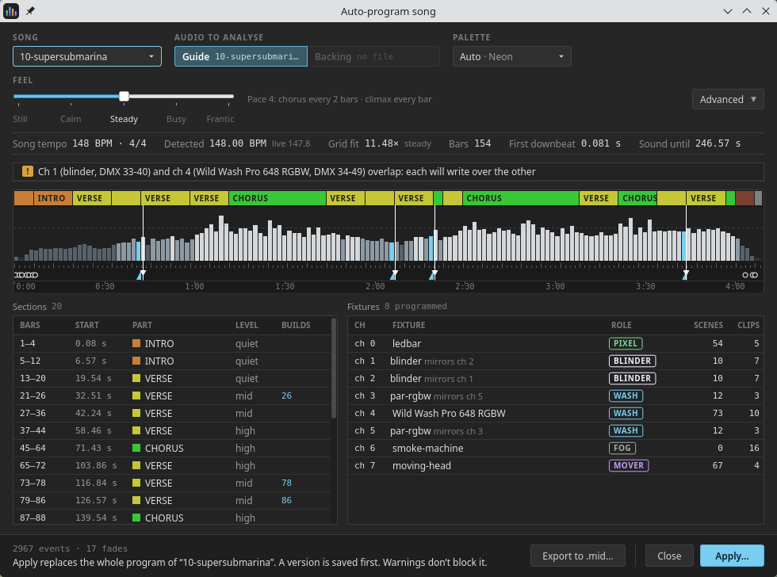
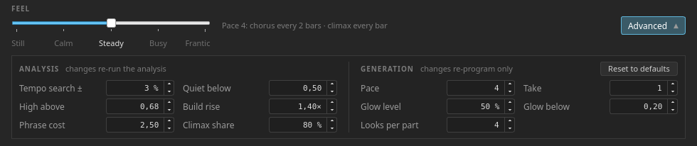
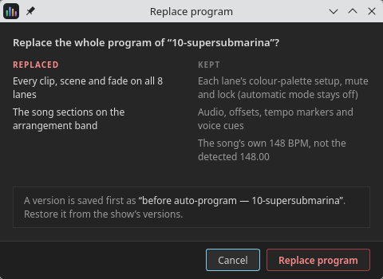

# 11. The auto program

The auto program writes a song's whole light show from its audio. It listens to
the recording for the beat grid, the sections, which sections repeat, where the
song builds and where it peaks, then programs every patched fixture: clips,
scenes, fades and the song sections on the arrangement band.

What it writes is an ordinary program. Every clip lands on the timeline exactly
as if you had placed it, so a generated show is a starting point you can edit,
not a black box you have to accept whole.

**☰ ▸ Auto program…** opens it on the song that is loaded, and the analysis
starts straight away. It is a desktop tool: neither the web remote nor a
headless rack box offers it.

> **Nothing in the show changes until you press Apply.** Everything you see in
> this dialog is a *take* written to a scratch file. Applying asks first, and
> saves a version of the song before it replaces anything
> ([11.6](#116-applying-a-take)).

## 11.1 The inputs

| Control | What it does |
|---|---|
| **SONG** | Any song in the setlist. Picking another one analyses that one |
| **AUDIO TO ANALYSE** | **Guide** or **Backing**, each showing its file name. A track the song does not have is greyed out. The guide is picked first when there is one, because a full mix says more about the song than a backing track with the band taken out |
| **PALETTE** | The colours the show is lit in — see below |

### Palettes

A palette is three colours and white, and every fixture wears it: the
**primary** is what most of the song wears, the **partner** goes with it, and
the **contrast** is kept back for choruses, bridges and accents. White is for
the hits.

| Choice | What you get |
|---|---|
| **Auto** | Picked from the song's key and how hard it drives. The box says which: `Auto · Neon` |
| **Acid … Sunset** | Ten presets, mixed by hand for LEDs. Each entry in the list shows its three colours |
| **Complementary … Single** | The six modes of the fixture **Palette** tab ([5.6](#56-the-palette-tab)), walked from a hue you choose in the swatch beside it. **Random** draws the hue from the take, and the swatch's tooltip names the one it drew, so a draw you like can be pinned |
| **Custom** | Three swatches beside the box — primary, partner, contrast. Click one to pick its colour |

Auto chooses **Ember** for a minor key that drives hard and **Ocean** for one
that does not, **Neon** for a major key that drives hard and **Sunset** for one
that does not.

> **One palette per song.** The choice is meant to be *which* palette, not more
> colours in one song. And it only borrows the Palette tab's arithmetic: the
> program writes its colours into its own looks, and never touches the
> fixture's own palette setting.

## 11.2 Feel

**FEEL** is how busy the show is: how often the looks change and how often the
fixtures take turns. Five stops:

| Feel | Pace | What it is like |
|---|---|---|
| **Still** | 0 | One look holds each section |
| **Calm** | 2 | Slow changes, few looks per part |
| **Steady** | 4 | The default. A loud chorus changes every 2 bars |
| **Busy** | 6 | Changes every couple of beats in the loud parts |
| **Frantic** | 8 | Changes on every beat |

The read-out beside the slider says what the pace means for *this* song, in its
own meter — `Pace 4: chorus every 2 bars · climax every bar`. The climax always
changes twice as often as a chorus. **At every pace the sections, the hits and
the builds still land**; the feel only decides what happens in between.

Changing the feel, the palette or anything else in the **Generation** group
re-programs from the analysis already made, which takes a fraction of a second.
Only a different song, a different track or an **Analysis** value runs the
analysis again.

## 11.3 Advanced

**Advanced** opens the values the engine actually uses. They come in two
groups, and the group says what a change costs.

**ANALYSIS** — *changes re-run the analysis*:

| Field | Default | What it moves |
|---|---|---|
| **Tempo search ±** | 3 % | How far from the song's own BPM (and from the tempo the analysis hears) the beat grid is searched for |
| **Quiet below** | 0.50 | Bars quieter than this, against the song's loud level, count as quiet |
| **High above** | 0.68 | Bars at least this loud count as high |
| **Build rise** | 1.40× | How much louder a bar must get, end against start, to count as a build |
| **Phrase cost** | 2.50 | What each extra section costs when the song is cut up. Higher gives fewer, longer sections |
| **Climax share** | 80 % | The climax is the last loud section with at least this share of the strongest one's energy |

**GENERATION** — *changes re-program only*:

| Field | What it does |
|---|---|
| **Pace** | 0–8, the number behind the Feel |
| **Take** | Another take at the same settings — other lead fixtures, other look orders, other choreographies. **Take 1 is the song's own** and comes out the same every time |
| **Glow level** | How much of its look the one fixture lighting the quietest sections gives |
| **Glow below** | A quiet section with less energy than this is lit by that single glow rather than by its whole lead group |
| **Looks per part** | The most looks one fixture steps through in a part of the song |

**The Feel is the base.** The Feel sets Pace, Glow level, Glow below and Looks
per part, and anything you change in Advanced goes on top of it: a changed
field is marked with a dot, and the button counts them — `Advanced 2 changed`.
Moving the Feel slider writes its own values back over those four.
**Reset to defaults** puts everything back.

> **Take is the cheapest way to try alternatives.** Step it up a few times and
> watch the Fixtures table: the same song, the same palette and the same pace,
> with a different fixture leading the verse.

## 11.4 Reading a take

While the analysis runs, the space under the inputs shows its three steps —
*Decoding*, *Analysing beats, bars and sections*, *Programming N fixtures* —
with a clock on each, and a **Cancel analysis** button. A first analysis takes a
few seconds.

### The summary strip

| Item | What it says |
|---|---|
| **Song tempo** | The song's own BPM and meter, as the timeline has them |
| **Detected** | The tempo the analysis fitted, and the rougher live estimate beside it |
| **Grid fit** | How well that beat grid fits the music. `steady` is good; **no steady beat** is a warning |
| **Bars** | How many bars it counted |
| **First downbeat** | Where bar 1 starts in the audio |
| **Sound until** | Where the music ends |

### The song map

One strip, the whole song:

- **the sections** along the top, coloured as on the timeline's arrangement band;
- **the loudness of every bar**, shaded from dark (quiet) to light (high),
  **cyan** where a bar is a build — the dashed line is the song's loud level;
- **the beat grid** under it, a tick every bar and a taller one every fourth,
  turning **amber** where the grid does not fit the music;
- **the markers**: cyan ramps for builds, **white flags** for the hits a build
  lands on (impacts), small **rings** for accents in the quiet passages.

Hover over a bar for its number, start, loudness and level.

### Sections and Fixtures

**Sections** lists what was found — bars, start, part (INTRO, VERSE, CHORUS…),
level and which bars are builds — ending with **END**.

**Fixtures** is one row per programmed fixture, with the **role** it was given:

| Role | Given to | What it does in a generated show |
|---|---|---|
| **MOVER** | Anything with pan or tilt | The library's looks, else beams swung either side of the floor, moving at every look change. Opens wide and white on the hits |
| **WASH** | Anything that mixes colour | The part's two palette colours, alternating at every look change |
| **PIXEL** | An LED bar with built-in animations | The fixture library's scenes tagged for each song part |
| **BLINDER** | White or dimmer only | Stays dark, and fires on the song's own hits — see below |
| **FOG** | A fog or haze machine | Haze at a quiet opening, and a puff into every build, every break, every chorus and the climax |

The grey note after a name tells you two more things: `mirrors ch 2` — the
fixture is half of a mirrored pair, and the two act as one — and
`also drives ch 8` — another fixture on the same DMX address, which simply
follows. A fixture that could not be programmed is listed dimmed, with the
reason: *nothing to program* (no channel the program knows how to use), or *not
resolvable* (a type the fixture library cannot find).

### Notices

Warnings appear in a list over the map: no steady beat, audio that is not at the
song's typed BPM, a stretch where the grid does not fit (a medley, a rubato
passage), fixtures whose DMX channels clash, fixtures skipped. **Warnings do not
block Apply** — they tell you where to look afterwards. The one thing that does
is a patch with nothing programmable in it.

The footer counts what the take holds: `1684 events · 40 fades`.

## 11.5 What it does with your rig

The program follows a handful of rules, and knowing them makes a take easier to
read — and easier to fix by hand.

- **A role comes from what a fixture can do, never from its name.** A fixture
  straight from the Open Fixture Library works without any setup.
- **Your scenes come first.** Scenes and chases tagged with a song part in the
  fixture's Scenes tab ([5.4](#54-the-scenes-tab)) are what it reaches for in
  that part, as long as their colours suit the palette; it builds looks of its
  own only where the library has nothing.
- **A mirrored pair is one fixture to the eye.** Two of the same fixture on
  opposite sides of the stage light together, change together and take every
  hit together.
- **The show builds to its climax.** A quiet verse lights fewer fixtures than
  a loud chorus, and a part that comes back lights at least what it lit before.
  On a rig of three or more fixtures (blinders aside), **one is held back, dark,
  until the climax** — the first moment the whole rig is lit.
- **A part looks alike each time it comes back**, with the same choreography.
- **A loud chorus is lit like the climax, and the climax stays above it**: it
  adds the held-back fixture, changes twice as often and strobes into its
  phrase lines.
- **The blinders are rationed.** They fire on the song's *own* hits — the hit a
  build lands on, and the sharpest attacks in the recording — and nowhere else.
  Only from the last run of choruses on do they also strobe, in short bursts.
- **The ending follows the recording**: a hard cut goes to black on the hit, a
  ringing chord rings out, a fade burns down.

## 11.6 Applying a take

**Apply…** asks before it does anything.

| Replaced | Kept |
|---|---|
| Every clip, scene and fade on every lane | Each lane's colour palette, mute and lock |
| The song sections on the arrangement band | The audio, both offsets, the tempo markers and the voice TTS |
| The tempo — **only** when the song had no BPM of its own | The song's own BPM, when it has one |

**Cancel is the default button.** **Replace program** first saves a pinned
version named `before auto-program — <song>`, then writes the take into the
song. If the result is not what you wanted, **☰ ▸ Restore version** brings the
hand-made program back ([7.4](#74-the-menu-history-and-the-rest)).

Applying to the loaded song stops the transport and reloads the timeline; any
other song simply has its MIDI file replaced, ready for when you go to it.

After that it is your program. Lock the lanes you are happy with, re-time a
hit, swap a look — the timeline cannot tell a generated clip from a hand-placed
one. The **A** (auto) button stays off on every lane, because every lane has
been programmed explicitly.

**Export to .mid…** writes the take to a MIDI file somewhere else and leaves the
show alone — for opening it in another tool, or keeping a take to compare.

## 11.7 Limits

- **One tempo per song.** A medley or a real tempo change gets a warning and an
  amber stretch on the map, not a second grid.
- **The voice detector can be fooled.** It is what tells a verse from an
  instrumental passage, and an instrument with a lot of vibrato can read as a
  singer.
- **Mirrored moving heads pan in parallel**, not in a fan.
- **Generate with the transport stopped.** It is allowed while a song plays,
  but the analysis is heavy work for the same machine that is feeding the
  audio.
